# 实验 3：谓词逻辑与 SMT 求解

**姓名：** 李文杰
**学号：** 10245101584

---

## 1. 实验主题
使⽤ Z3 建⽴有类型的 SMT 模型，使⽤谓词和量词表达⼀般规则，并通过模型、反例、不可满⾜核和优化结果回答软件⼯程问题。

## 2. 实验⽬标
- 理解布尔可满⾜性问题（Boolean satisfiability problem，SAT）与可满⾜性模理论（satisfiability modulo
theories，SMT）的差别，并正确使⽤布尔型（Bool）、整数型（Int）和位向量（BitVec）。
- 使⽤ Z3Py 把⾃然语⾔规则写成有类型的约束，从模型中还原并检查具体⽅案。
- 使⽤谓词、全称量词（universal quantifier）和存在量词（existential quantifier）表达⼀般规则，并通过加⼊性质的否定检查结论是否成⽴。
- 理解数学整数与机器整数的边界语义，使⽤不可满⾜核（unsatisfiable core，简称 unsat core）解释需求冲突，并区分可满⾜⽅案与最优⽅案。
<!-- 允许使⽤ LLM 协助编写候选约束或解释 API，但必须通过 Z3 运⾏、边界实例、反例或第⼆实现核验。如果使⽤ LLM ⽣成正式约束或代码，实验报告还应包含实际提⽰词、你最终采⽤或修改的内容和独⽴核验结果。 -->

## 3. ⼯具与参考资料
- Z3 Guide：Z3Py Introduction
- Programming Z3
- Z3 官⽅代码库
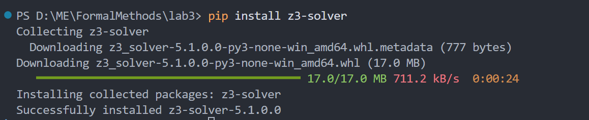
  
## 4. 最⼩环境检查（Smoke Test）
### 4.1 Z3Py
*保存为 z3_smoke.py：*
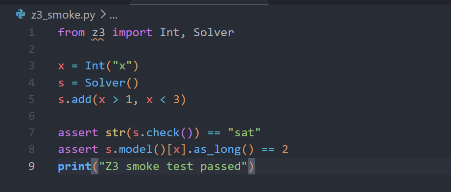
*运⾏：*`python3 z3_smoke.py`，环境正确时，应输出 Z3 smoke test passed。若导⼊失败，应先检查当前 Python 环境中安装的是 z3-
solver 包，⽽不是同名的其他包。


## 5. 实验任务
### 任务 1：同⼀部署场景的 CNF 与 SMT 表⽰
**任务摘要：** 对同⼀个软件部署问题分别建⽴布尔 CNF 和整数 SMT 模型，⽐较两种表⽰所需的变量、约束和领域解释。

某系统包含四个组件和三个部署节点：
| 组件 | 记号 |
|:-:|:-:|
| ⽹关（Gateway）| G |
|认证服务（Authentication）| A |
|数据库（Database）| D |
|缓存（Cache）| C |

节点编号为 0、1、2，每个组件必须部署到且仅部署到⼀个节点。**另有以下规则：**
1. ⽹关与数据库不能部署在同⼀节点。
2. 认证服务与数据库必须部署在同⼀节点。
3. 缓存不能部署在节点 0。
4. ⽹关只能部署在节点 0 或节点 1。
5. 如果缓存部署在节点 1，则⽹关必须部署在节点 0。

*完成以下⼯作：*
#### 5.1.1. 建⽴布尔变量`X_组件_节点`，其含义为“该组件部署在该节点”。为 4 个组件和 3 个节点建⽴共 12 个变量，把“每个组件恰好位于⼀个节点”和上述五条规则全部写成 CNF ⼦句，并使⽤ Z3Py 的`Bool`、`Or`和`Not`求出⼀个模型。

##### 5.1.1.1 建⽴12个布尔变量
| 组件\节点| 0 | 1 | 2 |
|:-:|:-:|:-:|:-:|
| G | X_G_0 | X_G_1 | X_G_2 |
| A | X_A_0 | X_A_1 | X_A_2 |
| D | X_D_0 | X_D_1 | X_D_2 |
| C | X_C_0 | X_C_1 | X_C_2 |

为了方便书写，下面使用\(G_0\)来代替`X_G_0`，其他变量同理。

##### 5.1.1.2 CNF ⼦句
**每个组件恰好位于⼀个节点：**

- 网关恰好在一个节点
\(G_0\lor G_1\lor G_2\),
\(\neg G_0\lor\neg G_1\),
\(\neg G_0\lor\neg G_2\),
\(\neg G_1\lor\neg G_2\)

- 认证服务恰好在一个节点
\(A_0\lor A_1\lor A_2\),
\(\neg A_0\lor\neg A_1\),
\(\neg A_0\lor\neg A_2\),
\(\neg A_1\lor\neg A_2\),

- 数据库恰好在一个节点
\(D_0\lor D_1\lor D_2\),
\(\neg D_0\lor\neg D_1\),
\(\neg D_0\lor\neg D_2\),
\(\neg D_1\lor\neg D_2\),

- 缓存恰好在一个节点
\(C_0\lor C_1\lor C_2\),
\(\neg C_0\lor\neg C_1\),
\(\neg C_0\lor\neg C_2\),
\(\neg C_1\lor\neg C_2\),

**规则1-⽹关与数据库不能部署在同⼀节点：**
\(\neg G_0\lor\neg D_0\),
\(\neg G_1\lor\neg D_1\),
\(\neg G_2\lor\neg D_2\),

**规则2-认证服务与数据库必须部署在同⼀节点：**
\(\neg A_0\lor D_0\),
\(\neg D_0\lor A_0\),

\(\neg A_1\lor D_1\),
\(\neg D_1\lor A_1\),

\(\neg A_2\lor D_2\),
\(\neg D_2\lor A_2\),

**规则3-缓存不能部署在节点 0：**
\(\neg C_0\),

**规则4-⽹关只能部署在节点 0 或节点 1：**
\(\neg G_2\),
\(G_0\lor G_1\),

**规则5-如果缓存部署在节点 1，则⽹关必须部署在节点 0：**
\(\neg C_1\lor G_0\).


##### 5.1.1.3 使⽤ Z3Py 求出⼀个模型

整合上方信息，将代码保存为`mission1.py`：
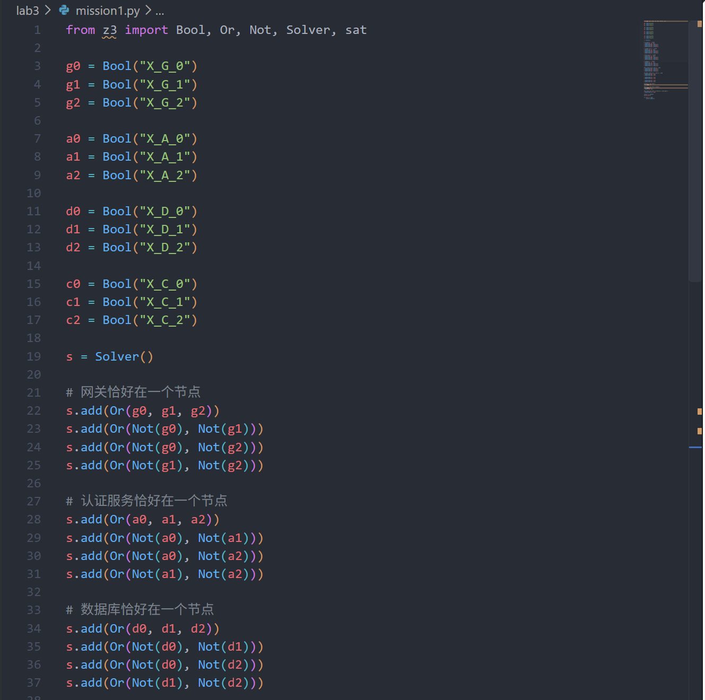
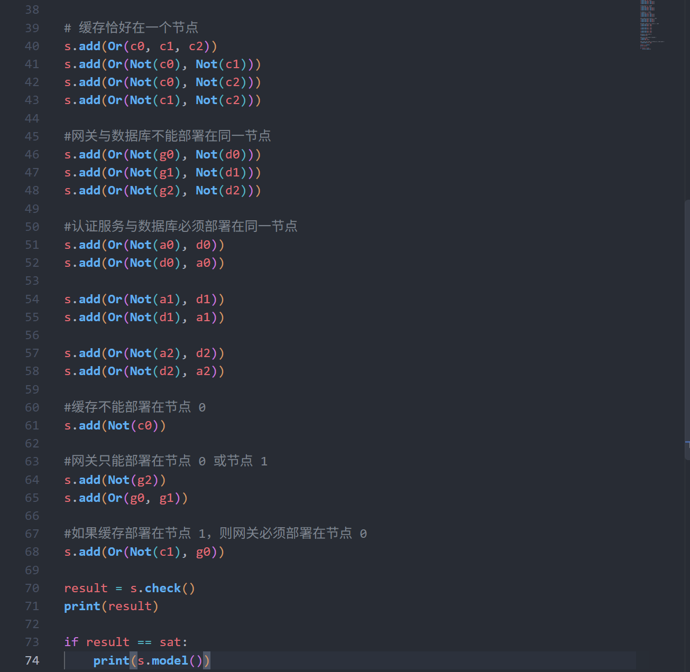

*运行：*
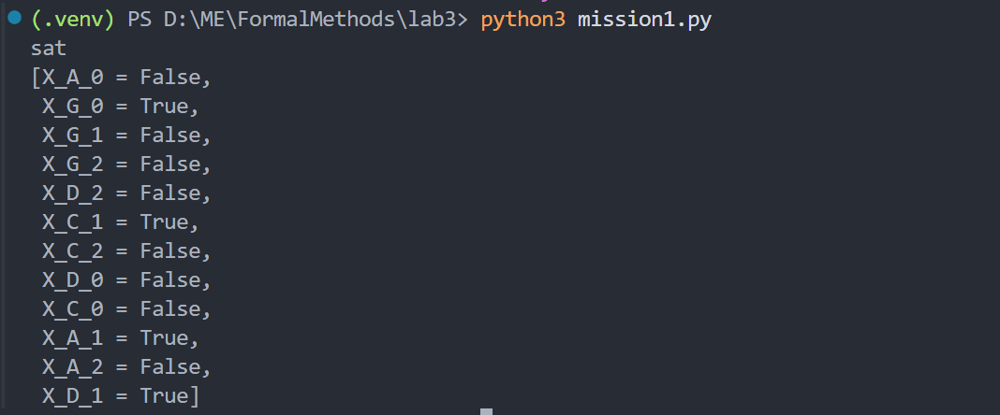
即`G=0, A=1, D=1, C=1`,
- 网关位于节点 0，
- 认证服务、数据库和缓存位于节点 1，
- 节点 2 空闲。
> 每个组件恰好部署在一个节点，且该方案满足全部五条部署规则

#### 5.1.2. 为四个组件分别建⽴⼀个取值范围为 `0..2` 的 `Int` 变量，⽤整数相等、不等、取值范围和 Implies 直接写出同⼀组规则，并求出⼀个模型。
##### 5.1.2.1 建模
因为是用`Int`变量表示，所以只需要四个变量即可，同时因为每个变量只能有一个取值所以必然满足`每个组件恰好位于⼀个节点`：
```py
#定义变量：
G = Int("G")
A = Int("A")
D = Int("D")
C = Int("C")

s = Solver()

#取值范围：
s.add(G >= 0, G <= 2)
s.add(A >= 0, A <= 2)
s.add(D >= 0, D <= 2)
s.add(C >= 0, C <= 2)

#规则1：
s.add(G != D)
#规则2：
s.add(A == D)
#规则3：
s.add(C != 0)
#规则4：
s.add(Or(G == 0, G == 1))
#规则5：
s.add(Implies(C == 1, G == 0))
```
##### 5.1.2.2 求解
保存并补充上述代码，存为`mission1_2.py`：
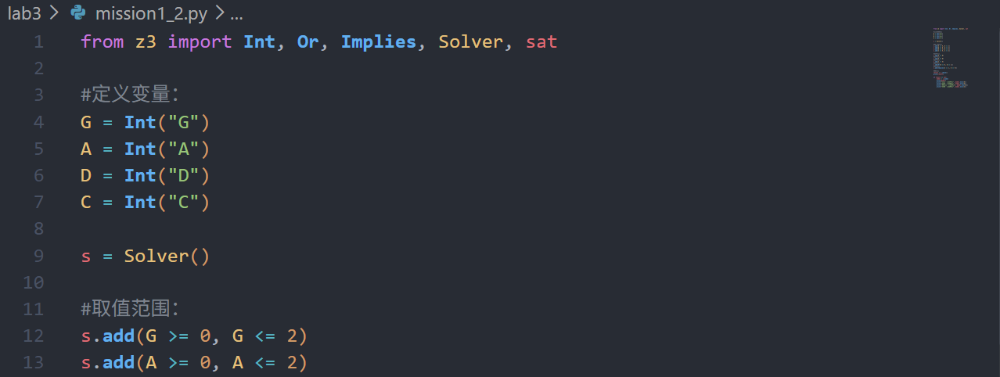
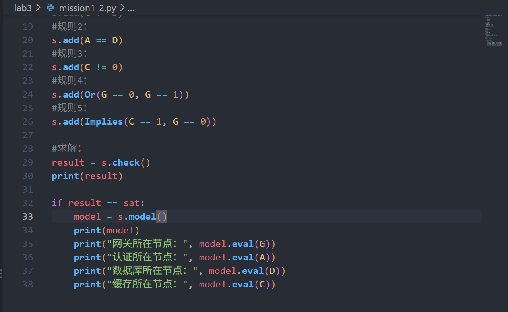
*运行：*
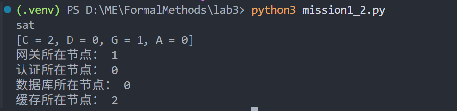

#### 5.1.3. ⽐较两种表⽰使⽤的变量数量、约束形式和可读性，并选择“认证服务与数据库同节点”这条规则，完整展⽰它在 CNF 和整数 SMT 中的两种写法
- 对比5.1.1与5.1.2的两个两种表示方式可以看出：**无论是变量数量，约束形式还是可读性，第二种的表达都更加简化方便，更具可读性。**
- 对于 **“认证服务与数据库同节点”** 这条规则，两种写法如下：
  - CNF：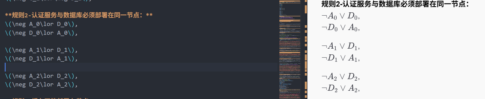
  - SMT：`s.add(A == D)`

<!-- 实验报告应包含： 
固定场景的变量表、完整 CNF ⼦句、整数 SMT 约束、两个 Z3 模型及其部署⽅案，以及两种表⽰的变量数量、约束形式和指定规则写法的⽐较；能够看清两次求解状态和模型的关键截图；以及你对CNF 与 SMT 表达差异⾃⾏撰写的结论。 -->

### 任务 2（编程题）：检查课程冲突排课⽅案
**任务摘要：** 实现⼀个 C++ 函数，判断给定排课⽅案是否满⾜时间段范围和全部课程冲突约束。

⼀般地，设有 `n` ⻔课程和 `k` 个时间段：
- 课程编号为 `0..n-1`。
- 时间段编号为 `0..k-1`。
- `slot` 包含 `n` 个元素，`slot[i]` 表⽰课程 `i` 使⽤的时间段。
- 冲突对 `(u,v)` 表⽰课程 `u` 与课程 `v` 不能使⽤同⼀时间段。

检查函数需要适⽤于任意符合接⼝约定的 `n、k` 和冲突列表。本任务使⽤下⾯的具体实例设计测试：某专业需要把六⻔课程安排到三个时间段，由同⼀位教师授课或选课名单有重叠的课程不能同时上课。本任务不考虑教室和课程容量。
- 本例课程编号为`0..5`
- 本例时间段编号为`0..2`
  
本任务使⽤的冲突关系为：
`(0,1), (0,2), (1,3), (2,3), (2,4), (3,5), (4,5)`

例如，`slot[0]=0, slot[1]=0` 违反冲突 `(0,1)`；当前冲突列表中没有 `(0,3)`，所以 `slot[0]=0, slot[3]=0`本⾝不违反规则。

请在 `lab3_solution.cpp` 中实现：
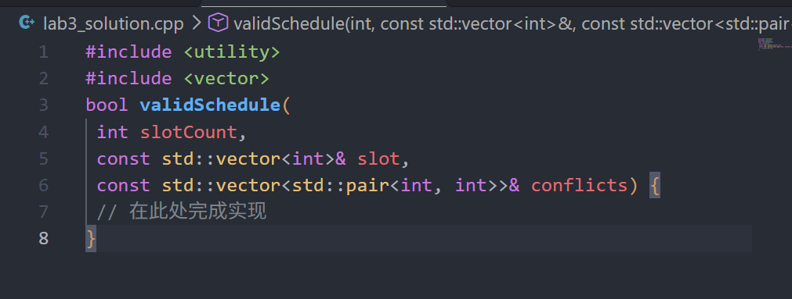
**接⼝约定：**
- 合法时间段编号为 `0` 到 `slotCount - 1`，其中 `1 <= slotCount <= 100`。
- `conflicts` 中的课程下标均合法；每对冲突课程必须位于不同时间段。
- 不在冲突列表中的课程可以位于同⼀时间段。
- 函数不得定义 main，不得进⾏标准输⼊输出；评分程序将使⽤ `C++17` 编译并直接调⽤该函数。

#### 5.2.1. 完成 `validSchedule`，依次检查每⻔课程的时间段编号是否有效，以及每对冲突课程是否被安排在不同时间段。
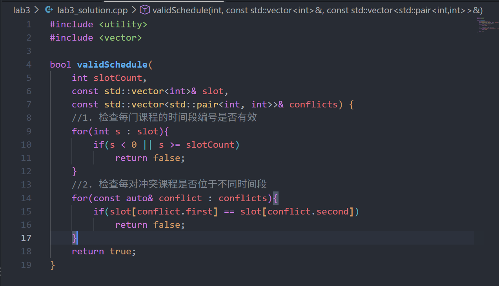

#### 5.2.2. ⾃⾏构造并运⾏四类测试：合法⽅案、时间段编号越界、冲突课程位于同⼀时间段、⾮冲突课程位于同⼀时间段且⽅案合法。

冲突列表：(0,1), (0,2), (1,3), (2,3), (2,4), (3,5), (4,5)
slotCount设置为3，设置测试用例如下：
| 测试类型 | `slot` | 预期返回 | 原因 |
|---|---|---|---|
| 合法方案 | `[0,1,2,0,0,1]` | `true` | 范围合法，全部冲突课程均错开 |
| 时间段越界 | `[3,1,2,0,0,1]` | `false` | 课程 0 使用了不存在的时间段 3 |
| 冲突课程同时上课 | `[0,0,2,0,0,1]` | `false` | 课程 0、1 冲突，却都在时间段 0 |
| 非冲突课程同时上课 | `[0,1,1,0,0,1]` | `true` | 课程 1、2 没有冲突，可以都在时间段 1 |

设计并保存测试代码为`test2.cpp`：
```c++
#include <iostream>
#include <utility>
#include <vector>

bool validSchedule(
    int slotCount,
    const std::vector<int>& slot,
    const std::vector<std::pair<int, int>>& conflicts);

int main() {
    const int slotCount = 3;
    const std::vector<std::pair<int, int>> conflicts = {
        {0, 1}, {0, 2}, {1, 3},
        {2, 3}, {2, 4}, {3, 5}, {4, 5}};

    const std::vector<std::vector<int>> tests = {
        {0, 1, 2, 0, 0, 1},  // 合法方案
        {3, 1, 2, 0, 0, 1},  // 时间段越界
        {0, 0, 2, 0, 0, 1},  // 冲突课程同时上课
        {0, 1, 1, 0, 0, 1}   // 非冲突课程共享时间段
    };

    const std::vector<bool> expected = {
        true, false, false, true
    };

    bool allPassed = true;
    std::cout << std::boolalpha;

    for (int i = 0; i < static_cast<int>(tests.size()); ++i) {
        bool actual = validSchedule(slotCount, tests[i], conflicts);
        bool passed = (actual == expected[i]);

        std::cout << "Test " << i + 1 << ": slot = [";
        for (int j = 0; j < static_cast<int>(tests[i].size()); ++j) {
            if (j > 0) {
                std::cout << ", ";
            }
            std::cout << tests[i][j];
        }
        std::cout << "]\n";

        std::cout << "  expected = " << expected[i]
                  << ", actual = " << actual
                  << ", " << (passed ? "PASS" : "FAIL") << "\n";

        if (!passed) {
            allPassed = false;
        }
    }

    return allPassed ? 0 : 1;
}
```
*运行如下：*
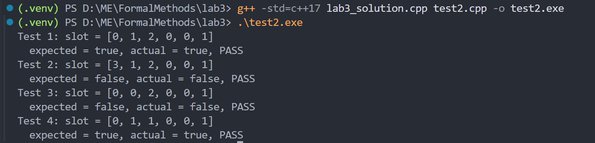

#### 5.2.3 从步骤 2 的合法测试中找出⼀对位于同⼀时间段但彼此不冲突的课程。⽤这对课程说明函数为什么只⽐较冲突课程，⽽不能要求所有课程的时间段都互不相同。
- 对于合法测试`slot = [0,1,1,0,0,1]`，课程 1, 2 都被安排在时间段 1，即：`slot[1]=slot[2]=1`。因为冲突列表中没有 (1,2)，所以它们可以同时上课的方案合法。
- 因此，如果要求所有课程的时间段都互不相同，就会错误地禁止非冲突课程同时上课，增加多余的限制，可能导致六门课程无法安排到三个时间段导致`unsat`。

<!-- 实验报告应包含： 最终 C++ 代码、四类测试的具体输⼊和实际返回值、两类检查与排课规则的对应关系，以及合法测试中共享时间段的⼀对⾮冲突课程；能够看清编译和测试结果的关键截图；以及你对“怎样判断⼀个给定排课⽅案是否合法”⾃⾏撰写的结论。 -->

### 任务 3：使⽤ Z3 求解课程冲突排课问题
**任务摘要：** 把课程时间段和冲突规则写成整数约束，让 Z3 ⾃动寻找合法⽅案，并观察新增冲突如何改变求解结果。

某专业需要把六⻔课程安排到若⼲时间段。课程编号为 `0..5`，`slot[i]` 表⽰课程 `i` 所在的时间段；冲突对`(u,v)` 表⽰两⻔课程不能同时上课，即` slot[u] != slot[v]`。

本任务使⽤以下冲突关系：`(0,1), (0,2), (1,3), (2,3), (2,4), (3,5), (4,5)`
#### 5.3.1. 为六⻔课程分别建⽴⼀个 Z3 Int 变量，加⼊时间段范围 0..2 和上述七条冲突约束，求出⼀个使⽤三个时间段的合法⽅案。把模型转换为任务 2 中 validSchedule 所需的 slot，调⽤该函数检查⽅案，并按时间段列出课程。
##### 5.3.1.1 求合法方案
六门课程对应六个变量：
```py
s0 = Int("slot[0]")
s1 = Int("slot[1]")
s2 = Int("slot[2]")
s3 = Int("slot[3]")
s4 = Int("slot[4]")
s5 = Int("slot[5]")

s = Solver()
```
时间段范围：
```py
s.add(s0 >= 0, s0 <= 2)
s.add(s1 >= 0, s1 <= 2)
s.add(s2 >= 0, s2 <= 2)
s.add(s3 >= 0, s3 <= 2)
s.add(s4 >= 0, s4 <= 2)
s.add(s5 >= 0, s5 <= 2)
```
七条冲突约束：
```py
s.add(s0 != s1)  # 冲突 (0,1)
s.add(s0 != s2)  # 冲突 (0,2)
s.add(s1 != s3)  # 冲突 (1,3)
s.add(s2 != s3)  # 冲突 (2,3)
s.add(s2 != s4)  # 冲突 (2,4)
s.add(s3 != s5)  # 冲突 (3,5)
s.add(s4 != s5)  # 冲突 (4,5)
```
保存上述信息至`mission3.py`：
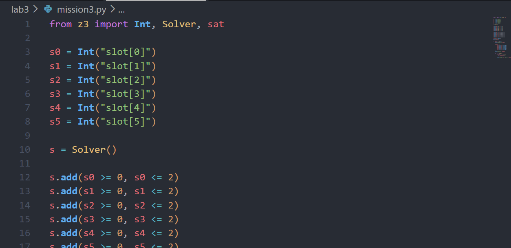
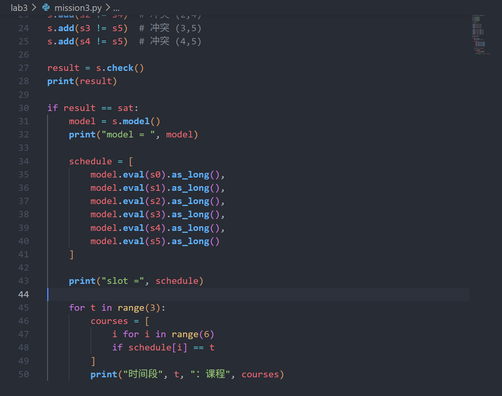
*运行：*合法方案如下：
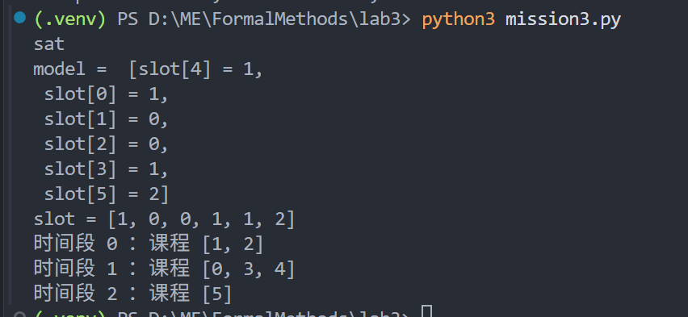

#### 5.3.2. 在冲突关系中增加 (0,3)。分别把所有课程的时间段限制在 0..1 和 0..2，记录两个求解结果。根据完整冲突列表找出⼀个⾜以说明两个时间段不可⾏的最⼩课程集合，并⽤该集合解释两个结果为什么不同。
##### 5.3.2.1 记录两次求解结果：
新增`s.add(s0 != s3)`冲突，可以新增一个`mission3_2.py`：
这里使用了LLM辅助代码编写：
- *LLM提示词：* 
> **我先把目前已完成的report部分保存，作为上下文，然后介绍了5.3.2的任务要求：**
> 请参考我的`mission3.py`代码,设计一份新的python代码，在原始七条课程冲突中新增(0,3)，分别检查两个和三个时间段下是否存在合法排课方案。

- *最终采用的内容：*
> `mission3_2.py`如下所示：
> 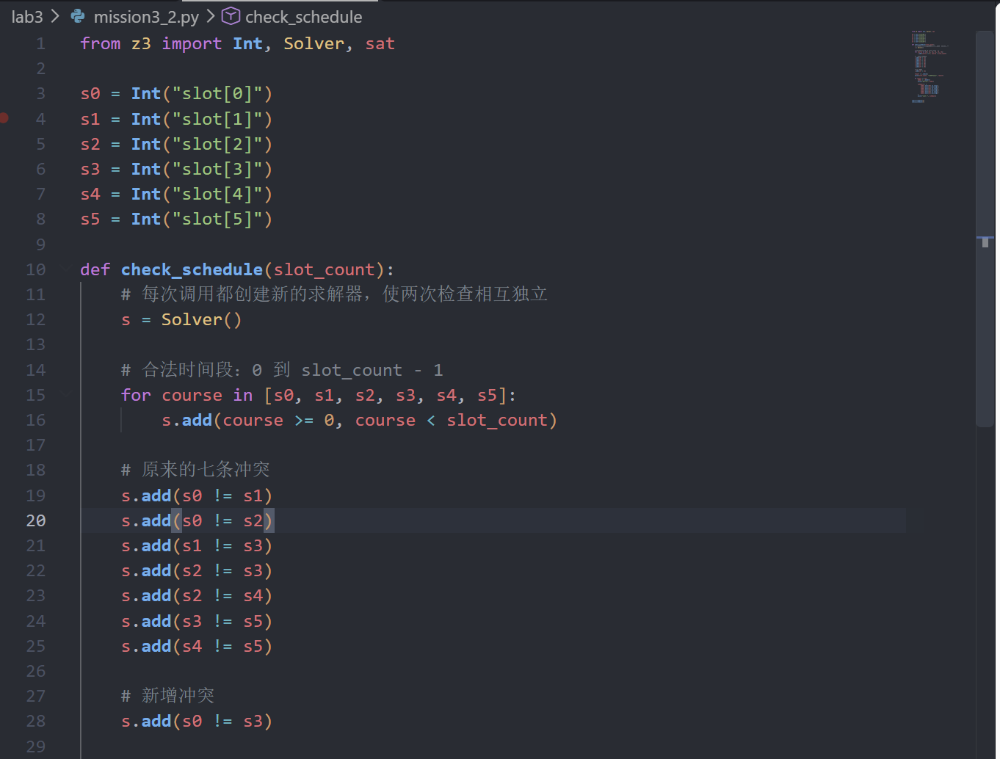
> 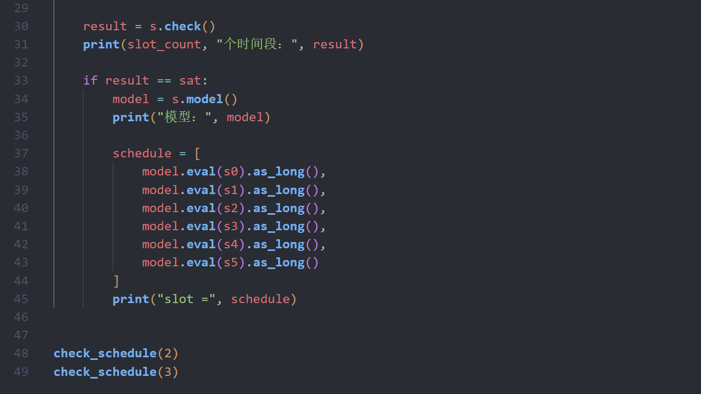

- *独立核验结果：*
> **运行核验：** 实际运行`mission3_2.py`，两个时间段的求解结果为 `unsat`，三个时间段的求解结果为 `sat`，具体结果见截图。
> **方案核验：** 对三个时间段下实际输出的方案，逐项检查六门课程的时间段均在 `0..2` 内，并逐条检查全部八条冲突对应的两门课程时间段不同，确认该方案合法，与 `sat` 结果一致。

运行结果如下：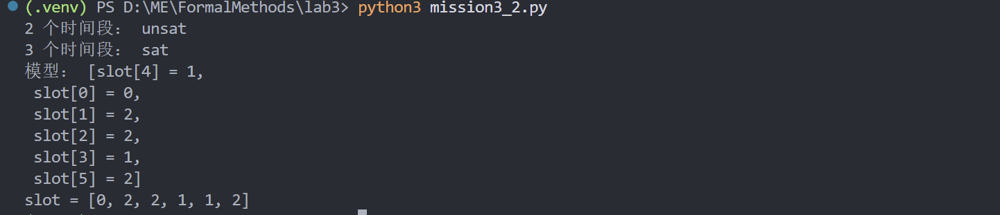
| 冲突课程对 | 对应时间段 | 检查结果 |
|---|---|---|
| `(0,1)` | 0、2 | 不同，满足 |
| `(0,2)` | 0、2 | 不同，满足 |
| `(1,3)` | 2、1 | 不同，满足 |
| `(2,3)` | 2、1 | 不同，满足 |
| `(2,4)` | 2、1 | 不同，满足 |
| `(3,5)` | 1、2 | 不同，满足 |
| `(4,5)` | 1、2 | 不同，满足 |
| **`(0,3)`** | 0、1 | 不同，满足 |

##### 5.3.2.2 说明两个时间段不可行的最小课程集合：
> **完整冲突列表**：(0,1), (0,2), (1,3), (2,3), (2,4), (3,5), (4,5), **(0, 3)**

**说明两个时间段不可行最小课程集合**为： **`{0,1,3}`**
**解释两个结果为什么不同：** 因为冲突列表中包含 `(0,1)`、`(1,3)` 和新增的 `(0,3)`，这三门课程两两冲突，所以必须使用三个不同的时间段。因此，`0..1` 的结果是` unsat`，而 `0..2` 的结果是 `sat`。

**约束求解器怎样从规则中寻找排课方案：**

- 先将每门课的时间段表示为整数变量，再用取值范围约束保证时间段合法，用不等式约束保证冲突课程不会同时上课。
- 随后，求解器再通过搜索能同时满足全部约束的变量赋值，利用约束推理来排除不符合规则的选择。
- 如果找的到，就返回 sat，模型中的变量值就是一份合法排课方案；反之，返回 unsat。

<!-- 实验报告应包含： Z3 变量、时间段范围和七条冲突约束、原问题的三时间段⽅案及 validSchedule 检查结果、增加 (0,3) 后使⽤两个和三个时间段的求解结果，以及说明两个时间段不可⾏的最⼩课程集合；能够看清求解状态、模型和检查函数结果的关键截图；以及你对“约束求解器怎样从规则中寻找排课⽅案”⾃⾏撰写的结论。 -->

### 任务 4：⽐较 Int 与 8 位 BitVec 的加法语义
**任务摘要：** 使⽤三种数值语义检查同⼀个性质“x+1 是否⼀定⼤于 x”，理解数学整数、⽆符号位向量和有符号位向量在边界处为什么得到不同结果。

Z3 的 `Int` 表⽰没有固定位宽的数学整数。`BitVec("x", 8)` 表⽰ 8 位位向量，加法结果只保留低 8 位。同⼀个 8 位结果可以按⽆符号数或有符号数解释：`UGT(a, b)` 进⾏⽆符号⼤于⽐较，`a > b` 对位向量进⾏有符号⼤于⽐较。

**本任务检查性质：** `x + 1 > x`

为了让 Z3 寻找该性质的反例，应向求解器加⼊它的否定，即“加⼀后的值不⼤于原值”。保存以下⽆符号版本为`unsigned_increment.py`：
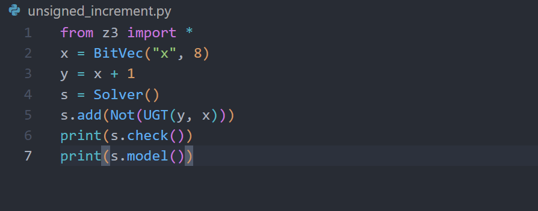

#### 5.4.1. 运⾏⽆符号版本，记录反例中的 `x`，计算对应的 `y`，并根据 8 位⽆符号数的取值范围解释为什么“加⼀后更⼤”在该输⼊上不成⽴。
**运行结果如下：**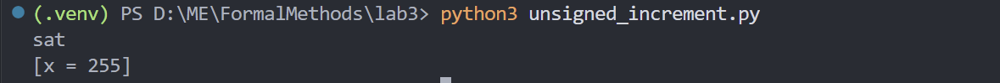

反例的 `x = 255`, 二进制表示是 `1111 1111`。所以在计算`y = x + 1`时会发生溢出（8 位无符号数的范围是：0 ~ 255 ）：
```
  11111111    255
+ 00000001      1
-----------
1 00000000    256
```
在只取低8位后，结果是 `y = 0 < x`。

#### 5.4.2. 保持 `x`、`y` 和 8 位加法不变，把待检查性质改为有符号⽐较，使⽤` Not(y > x) `寻找反例。记录反例，并按 8 位有符号数解释 x 和 y。
新增`signed_increment.py`：
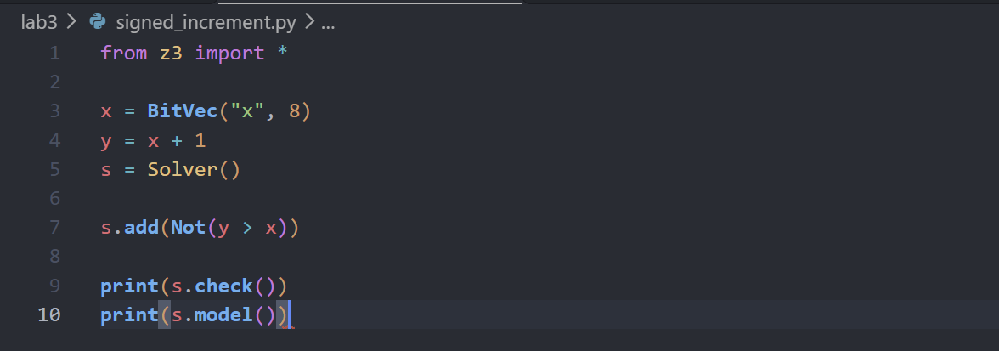
运行结果：
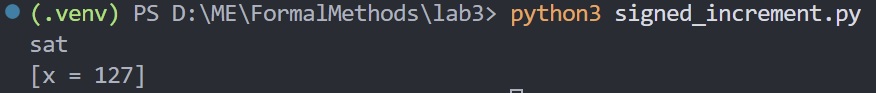
因为 8 位有符号数的范围是：`-128 ~ 127`, 所以当`x = 127`时，有
```
    x    + 1 =     y
01111111   →   10000000
   127            -128
```

#### 5.4.3. 重新建⽴⼀个类型为 Z3 `Int` 的变量，⽤数学整数加法重写同⼀个性质“加⼀后不⼤于原值”，运⾏求解器并解释为什么结果与两个 `BitVec` 版本不同。
新增`mission4.py`：
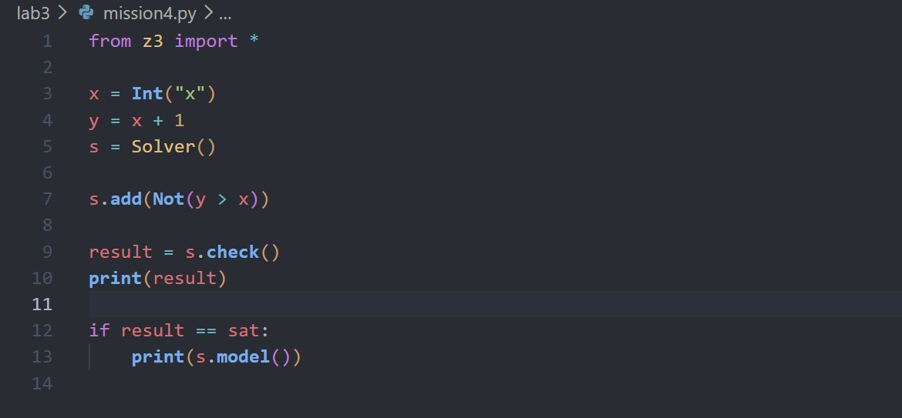
运行结果如下：
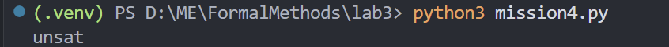
**不同的原因**：

- 因为Z3的`Int`表示**没有固定位宽限制**的数学整数，不会发生溢出的现象。
- 在这种情况下，`x+1>x`对任意整数都成立，所以其否定没有解。所以结果为`unsat`。

#### 5.4.4. 建⽴对照表，分别列出数学整数、8 位⽆符号位向量和 8 位有符号位向量的取值范围、⽐较⽅式、求解结果、反例和边界处的加法结果。

| 数值语义 | 取值范围 | 比较方式 | 求解结果 | 反例 x | 对应的 y （边界处的加法结果） |
|:-:|:-:|:-:|:-:|:-:|:-:|
| 数学整数 | 全体整数 | `y > x` | `unsat` | 无 | 始终等于数学意义的 x + 1 |
| 8位无符号位向量 | 0 ~ 255 | `UGT(y, x)` | `sat` | 255 | 0 |
| 8位有符号位向量 | −128 ~ 127 | `y > x` | `sat` | 127 | −128 |

<!-- 实验报告应包含： 三种模型及运⾏命令、各⾃的求解结果、两个 BitVec 反例的数值解释、三种语义的对照
表；能够看清反例和 Int 求解状态的关键截图；以及你对“变量类型为什么会改变验证结论”⾃⾏撰写的结论。 -->

### 任务 5：使⽤谓词和量词检查模块发布条件
**任务摘要：** 使⽤谓词表⽰软件模块的测试与发布状态，使⽤全称量词表达所有模块共同遵守的规则，并使⽤存在量词和性质否定检查结论。

谓词（predicate）⽤于表⽰对象是否具有某种性质。
本任务包含 `Parser`、`Database` 和 `UI` 三个软件模块，并定义两个⼀元谓词：`Tested(x)` 表⽰模块 `x` 已经通过测试，`Releasable(x)` 表⽰模块 `x` 可以发布。下⾯已经给出模块类型、测试状态事实和两条发布规则组成的基础模型：
```python
from z3 import *
Module, (Parser, Database, UI) = EnumSort(
 "Module", ["Parser", "Database", "UI"])
Tested = Function("Tested", Module, BoolSort())
Releasable = Function("Releasable", Module, BoolSort())
m = Const("m", Module)
base_constraints = [
 Tested(Parser),
 Not(Tested(Database)),
 Tested(UI),
 ForAll([m], Implies(Tested(m), Releasable(m))),
 ForAll([m], Implies(Releasable(m), Tested(m)))
]
base_solver = Solver()
base_solver.add(base_constraints)
print(base_solver.check())
model = base_solver.model()
for module in [Parser, Database, UI]:
 print(module,
 model.eval(Tested(module)),
 model.eval(Releasable(module)))
```
其中，`Parser` 和 `UI` 已经通过测试，`Database` 尚未通过测试。两个 `ForAll` 规则表⽰：
- 已经通过测试的模块可以发布；
- 可以发布的模块⼀定已经通过测试。

该基础模型可满⾜，并且两条规则共同要求每个模块的`Tested`与`Releasable` 取值⼀致。在此基础上完成以下⼯作：

#### 5.5.1. 分别检查以下三个性质是否由事实和规则推出：*存在至少一个可以发布的模块；* *`Database` 不可以发布；* *所有模块都可以发布。* 分别使用存在量词（existential quantifier）`Exists`、逻辑否定 `Not` 和 `ForAll` 表示这三个性质。每次建立独立检查，在基础约束中加入待检查性质的否定：结果为 `unsat` 表示性质必然成立，结果为 `sat` 表示模型给出了不满足该性质的情况。

##### 5.5.1.1 使用存在量词表示三个性质：
- **存在至少一个可以发布的模块；** 
  \(\exists m,\ Releasable(m)\),

  ```Z3
  Exists([m], Releasable(m))
  ```

- **`Database` 不可以发布；** 
  \(\neg Rleasable(Database)\),

  ```Z3
  Not(Releasable(Database))
  ```

- **所有模块都可以发布。**  
  \(\forall m, Releasable(m)\),

    ```Z3
  Forall([m], Releasable(m))
  ```

##### 5.5.1.2 检查是否可以推出：
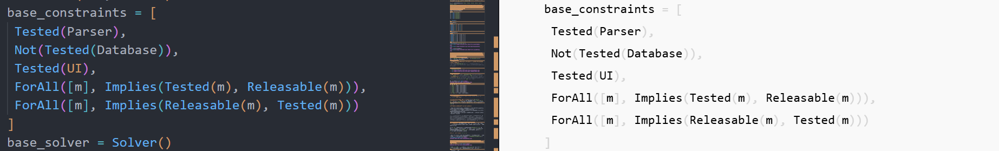
首先，根据代码可以分析出：

\(Test(Parser)\), \(Test(UI)\), \(\neg Test(Database)\),
\(\forall m,\ Tested(m)\Rightarrow Releasable(m)\),
\(\forall m,\ Releasable(m)\Rightarrow Tested(m)\).

所以有：
\(Rleasable(Parser)\), \(Rleasable(UI)\), \(\neg Rleasable(Database)\)

所以可以推出：**存在至少一个可以发布的模块**, **`Database` 不可以发布** 这2个性质成立，而 **所有模块都可以发布**不成立。

##### 5.5.1.3 。每次建立独立检查，在基础约束中加入待检查性质的否定：结果为 `unsat` 表示性质必然成立，结果为 `sat` 表示模型给出了不满足该性质的情况。
下面将用代码来进行独立检查：(新增检查性质函数`check_property`，整个文件命名为`mission5.py`)
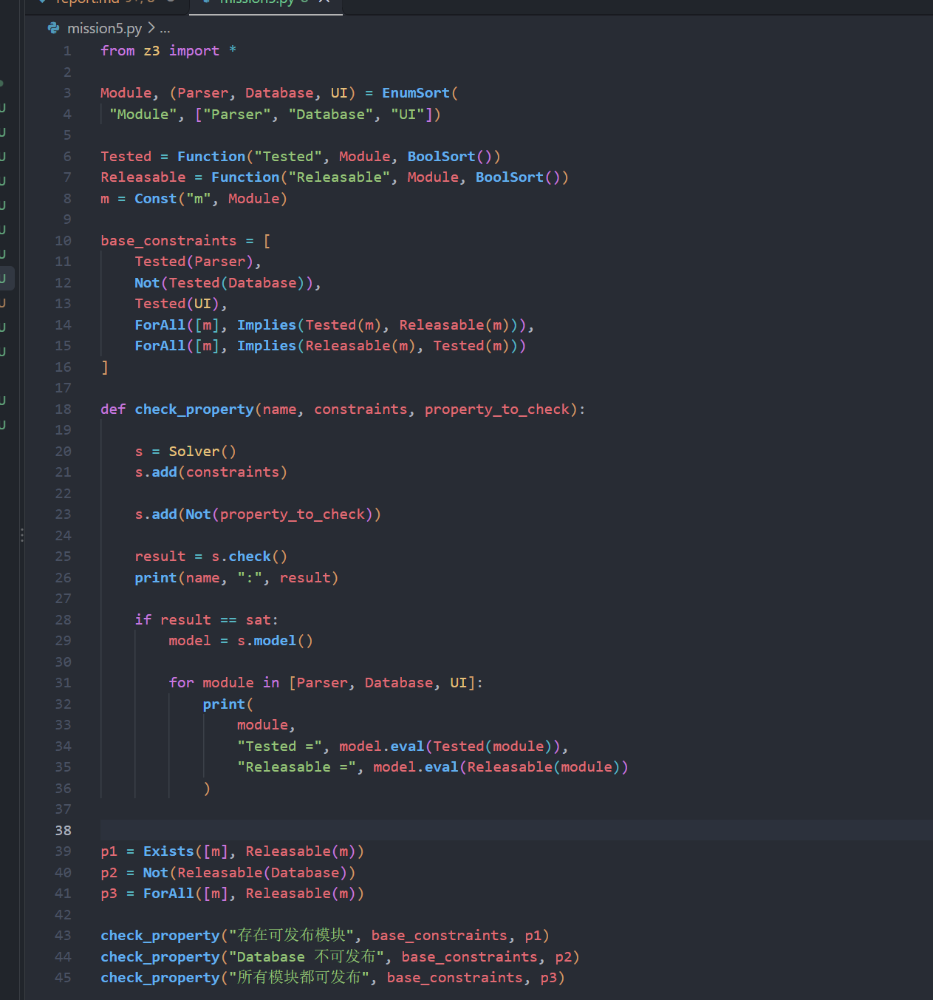
运行结果如下：
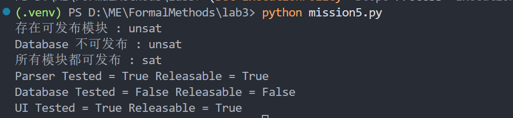

| 性质 | 反例检查结果 | 原因 | 结论 |
|---|---|---|---|
| 存在可发布模块 | `unsat` | Parser、UI都可发布，不可能不存在 | 性质成立 |
| Database 不可发布 | `unsat` | Database未通过测试，不可发布 | 性质成立 |
| 所有模块都可发布 | `sat` | Database不可发布，构成反例 | 性质不成立 |

#### 5.5.2. 将基础事实中的“`Database` 尚未通过测试”替换为“`Database` 已经通过测试”，再次检查“所有模块都可以发布”。⽐较修改前后的结果，并解释⼀个事实的变化如何通过全称规则改变三个模块的发布状态。
- 将基础事实中的“`Database` 尚未通过测试”替换为“`Database` 已经通过测试”：
\(Test(Parser)\), \(Test(UI)\), \(Test(Database)\)。
- 再次检查：
新增`mission5_2.py`,把`Not(Tested(Database))`改为`Tested(Database)`，再次运行结果如下：
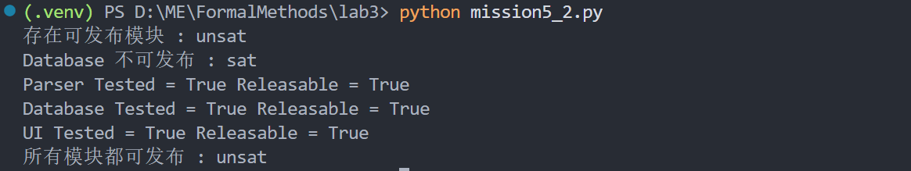

| 模块 | 修改前的发布状态 | 修改后的发布状态 |
|---|---|---|
| Parser | 可发布 | 可发布 |
| Database | 不可发布 | 可发布 |
| UI | 可发布 | 可发布 |

将`Database`从未测试改为已测试后，因为`ForAll([m], Implies(Tested(m), Releasable(m)))`，所以有`Releasable(Database)`，Database可以发布。因此：
- `Database 不可发布`从成立变成不成立
- `所有模块都可发布`从不成立变成成立
- `存在可发布模块`依旧都成立。

> **如何使用性质的否定判断结论是否由规则推出?**
在基础约束中加入待检查性质的否定，可以让求解器搜索反例。如果结果为`unsat`，说明不存在反例，所以性质成立；若结果为`sat`，说明存在反例，性质不成立。

<!-- 实验报告应包含： 模块枚举类型、两个谓词、测试状态事实、两条全称量词规则和三个待检查性质；各次检查的 sat/unsat 结果及其含义；修改 Database 测试状态前后的对照；能够看清求解状态和三个模块关键谓词取值的截图；以及你对“如何使⽤性质的否定判断结论是否由规则推出”⾃⾏撰写的结论。 -->

### 任务 6：使⽤不可满⾜核解释服务部署冲突
**任务摘要：** 在给定的服务部署模型上提取不可满⾜核，把核中的标签还原为容量冲突，并通过删除约束检查这个核是否还能缩⼩。

**不可满⾜核（unsatisfiable core）** 是⼀组已经⾜以导致⽆解的带标签约束。求解器返回的核不⼀定是所有可能冲突中约束数量最少的⼀组，因此还需要通过删减约束继续检查。

某系统准备在维护期间部署 API、任务处理器和数据库。
API ⾄少需要两个副本，
每个 API 副本都需要⼀个任务处理器副本，
数据库⾄少需要两个副本，
系统还必须预留⼀个备⽤节点。
每个服务副本和备⽤节点都独占⼀个节点，⽽维护期间最多只有六个节点可⽤。
系统另外要求启⽤监控，并规定启⽤监控时必须启⽤审计。

*保存以下模型为 `deployment_core.py`：*
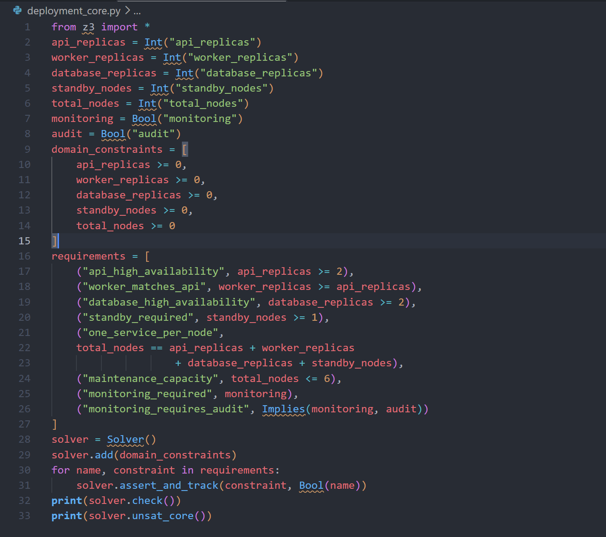
其中，`domain_constraints` 只规定变量的基本取值范围；`requirements` 中的⼋条带标签约束对应需要分析的部署要求。
#### 5.6.1. 运⾏给定模型，记录求解结果和 `unsat_core()` 返回的全部标签。
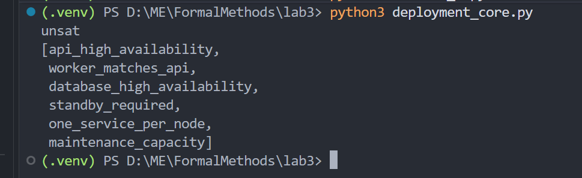
求解结果：`unsat`
返回标签：
```python
api_high_availability,
worker_matches_api,
database_high_availability,
standby_required,
one_service_per_node,
maintenance_capacity
```

#### 5.6.2. 把核中的每个标签还原为⾃然语⾔要求，根据副本数、节点计算关系和维护期间的节点上限，说明这些要求为什么不能同时满⾜；同时说明哪些带标签要求没有出现在核中。
##### 5.6.2.1 把核中的每个标签还原为⾃然语⾔要求：
| 核中的标签 | 对应的自然语言要求 |
|---|---|
| `api_high_availability` | API 至少需要两个副本 |
| `worker_matches_api` | Worker 副本数不少于 API 副本数（每个 API 副本都需要一个任务处理器副本） |
| `database_high_availability` | 数据库至少需要两个副本 |
| `standby_required` | 系统必须预留一个备用节点 |
| `one_service_per_node` | 每个服务副本和备用节点独占一个节点 |
| `maintenance_capacity` | 维护期间最多有六个节点可用 |

##### 5.6.2.2 根据副本数、节点计算关系和维护期间的节点上限：
\(total\_nodes 
= api\_replicas + worker\_replicas + database\_replicas + standby\_nodes
\ge 2 + 2 + 2 + 1 = 7\)
##### 5.6.2.3 说明这些要求为什么不能同时满足；同时说明哪些带标签要求没有出现在核中:
- 因为`maintenance_capacity`规定了维护期间最多有六个节点可用，而由`5.6.2.2`可知，\(total\_replicas\)至少为7才可以满足其他要求，因此产生冲突，不可同时满足。
- 标签`monitoring_required`（系统另外要求启用监控）,`monitoring_requires_audit`（启用监控时必须启用审计）这两个标签没有出现在核里。

#### 5.6.3. 对核中的每条约束分别做⼀次删减检查：每次重新建⽴求解器，保留领域约束和其余部署要求，删除当前这⼀条后重新求解，记录结果并判断当前核是否已经不能继续删减。另外选择⼀条监控或审计约束单独删除并求解，⽐较它与删除容量冲突约束后的结果。
新增`mission6.py`，把原有的输出改为这段：
```python
print("逐条删减检查：")

for removed_name, _ in requirements:
    # 每次创建新的求解器
    test_solver = Solver()

    # 保留全部领域约束
    test_solver.add(domain_constraints)

    # 只删除当前要求，其余要求全部保留
    for name, constraint in requirements:
        if name != removed_name:
            test_solver.add(constraint)

    result = test_solver.check()
    print("删除", removed_name, "后：", result)
```
运行结果如下：
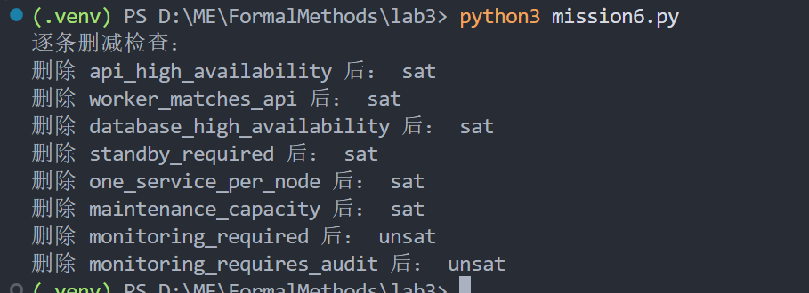
- 前面6条是对核中约束做的删减检查：可以发现删除任意一条后结果都为`sat`了
- 最后两条是额外对监控或审计约束单独删除并求解的结果，这里选择*删除对监控(`monitoring_required`)的约束*：
    - 删除`monitoring_required`约束后，容量冲突依旧存在，所以结果为`unsat`
    - 而删除容量约束后，结果为`sat`

> **不可满足核中的约束与其它约束有什么区别:**
不可满足核中的约束是原约束集合中一个已经会导致无解的子集，核内约束共同构成某一组冲突原因，核外约束不是形成这组冲突所必需的。其他核外约束被删除后，核内的矛盾任然存在，无法`sat`。

<!-- 实验报告应包含： 给定模型的运⾏结果、不可满⾜核、标签与⾃然语⾔要求的对应、容量冲突的计算说明、每条核⼼约束的删减结果，以及删除⼀条⾮核⼼约束后的结果；能够看清不可满⾜核和删减检查结果的关键截图；以及你对“不可满⾜核中的约束与其它约束有什么区别”⾃⾏撰写的结论。 -->

### 任务 7：求解使⽤时间段最少的排课⽅案
**任务摘要：** 在固定课程冲突关系上建⽴优化⽬标，求出使⽤时间段最少的排课⽅案，并解释新增冲突为什么改变最优值。

需要将六⻔课程安排到⾄多三个候选时间段。课程编号为 `0..5`，时间段编号为 `0..2`。每⻔课程必须选择⼀个时间段，下⾯每对存在冲突的课程不能使⽤同⼀时间段：
`(0,1), (0,2), (1,3), (2,3), (2,4), (3,5), (4,5)`

**完成以下⼯作：**
#### 5.7.1. 使⽤六个 Z3 Int 变量建⽴上述排课模型，并确认在三个候选时间段内存在合法⽅案。
这个任务和`5.3.1`的要求一致，我们使用下面6个变量表示6门课程：
s0 = Int("slot[0]")
s1 = Int("slot[1]")
s2 = Int("slot[2]")
s3 = Int("slot[3]")
s4 = Int("slot[4]")
s5 = Int("slot[5]")
时间段范围：
s.add(s0 >= 0, s0 <= 2)
s.add(s1 >= 0, s1 <= 2)
s.add(s2 >= 0, s2 <= 2)
s.add(s3 >= 0, s3 <= 2)
s.add(s4 >= 0, s4 <= 2)
s.add(s5 >= 0, s5 <= 2)
七条冲突约束：
s.add(s0 != s1)  # 冲突 (0,1)
s.add(s0 != s2)  # 冲突 (0,2)
s.add(s1 != s3)  # 冲突 (1,3)
s.add(s2 != s3)  # 冲突 (2,3)
s.add(s2 != s4)  # 冲突 (2,4)
s.add(s3 != s5)  # 冲突 (3,5)
s.add(s4 != s5)  # 冲突 (4,5)
运行`mission3.py`代码，结果也是一样的：
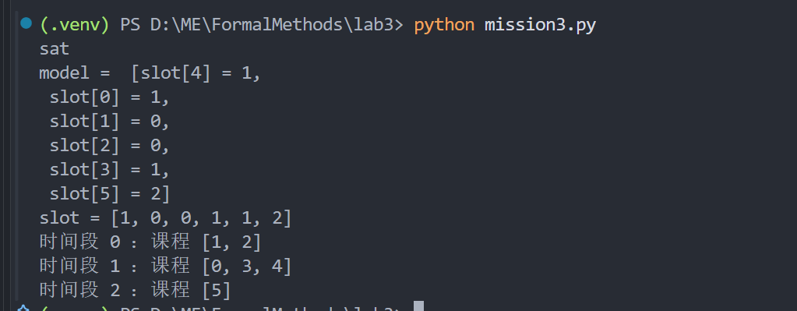
#### 5.7.2. 为三个时间段分别建⽴布尔变量 used[t]，加⼊ used[t] == Or(slot[i] == t)，使其准确表⽰“⾄少⼀⻔课程使⽤时间段 t”；使⽤ Sum(If(used[t], 1, 0)) 表⽰实际使⽤的时间段数。
代码如下：
```python
used0 = Bool("used[0]")
used1 = Bool("used[1]")
used2 = Bool("used[2]")

# used[t] == Or(slot[i] == t)
s.add(used0 == Or(s0 == 0, s1 == 0, s2 == 0, s3 == 0, s4 == 0, s5 == 0))
s.add(used1 == Or(s0 == 1, s1 == 1, s2 == 1, s3 == 1, s4 == 1, s5 == 1))
s.add(used2 == Or(s0 == 2, s1 == 2, s2 == 2, s3 == 2, s4 == 2, s5 == 2))

# Sum(If(used[t], 1, 0))
objective = Sum(If(used0, 1, 0), If(used1, 1, 0), If(used2, 1, 0))
```

#### 5.7.3. 使⽤ Z3 Optimize 最⼩化实际使⽤的时间段数，记录原冲突关系下的最优值和⼀个最优⽅案，并逐条检查全部冲突。
新增`mission7.py`：
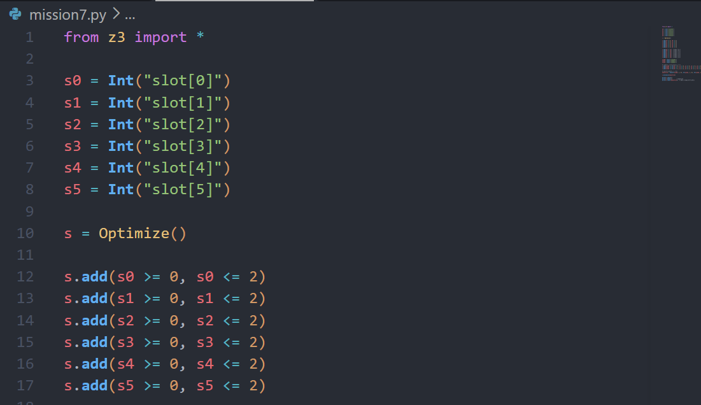
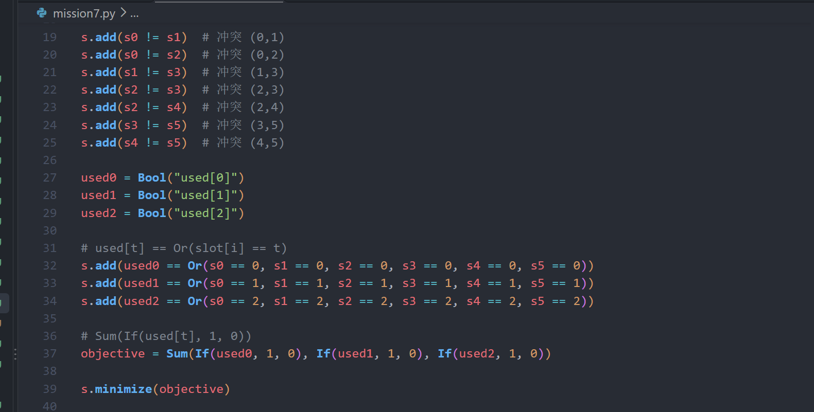
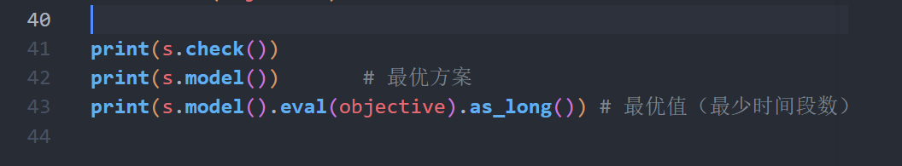
运行结果如下：
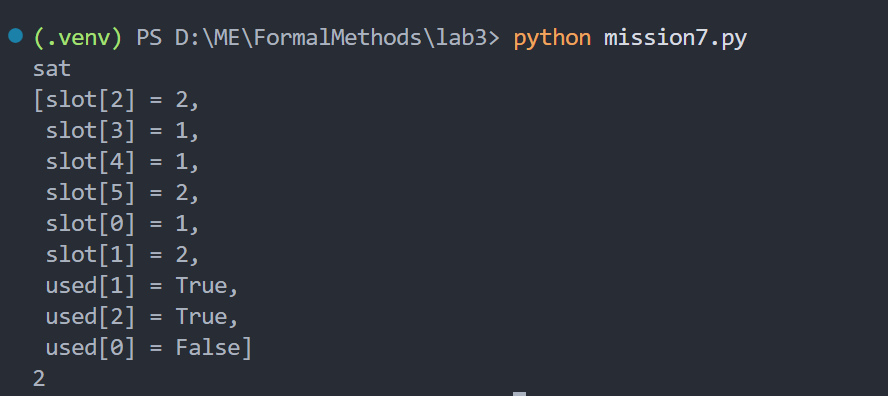
- **最优值**：2
- **最优方案**：slot = [1, 2, 2, 1, 1, 2]
- **逐条检查全部冲突**：

| 冲突对(u,v) | 课程u的时间段 |	课程v的时间段 |	结果 |
|---|---|---|---|
| (0,1)	| s0=1 | s1=2 | 不冲突 |
| (0,2)	| s0=1 | s2=2 | 不冲突 |
| (1,3)	| s1=2 | s3=1 | 不冲突 |
| (2,3)	| s2=2 | s3=1 | 不冲突 |
| (2,4)	| s2=2 | s4=1 | 不冲突 |
| (3,5)	| s3=1 | s5=2 | 不冲突 |
| (4,5)	| s4=1 | s5=2 | 不冲突 |

#### 5.7.4. 在原冲突关系中增加⼀条新的冲突 (1,2) 后重新优化，⽐较修改前后的最少时间段数。根据修改后的冲突列表找出⼀个能够给出新最优值下界的课程集合，再⽤求得的⽅案说明该下界可以达到。
新增`mission7_2.py`，增加`s.add(s1 != s2)`约束，运行结果如下：
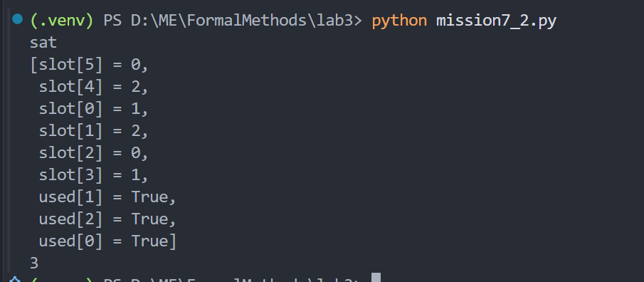
现在的**最少时间段数**由修改前的**2**变成**3**
新最优值下界的课程集合为：
|课程 | 0 | 1 | 2 | 3 | 4 | 5 |
|---|---|---|---|---|---|---|
| **时间**| 1 | 2 | 0 | 1 | 2 | 0 |

增加冲突`(1,2)`后，课程`{0,1,2}`中存在三条冲突关系：`(0,1)`、`(0,2)`和`(1,2)`。
由于这三门课程两两冲突，它们必须安排在三个不同的时间段，因此任何合法排课方案都至少需要三个时间段，即最优值的下界为3。

> 可满足方案与最优方案有什么区别：
> - 可满足方案只要**不违反任何冲突**就行，不用去注意用的时间段的多少
> - 而最优方案则是在所有可满足方案里，选择所用时间段最少的那个。

<!-- 实验报告应包含： 完整排课约束、used[t] 的定义、优化⽬标、原冲突关系和新增 (1,2) 后的最优值与最优⽅案、新最优值的下界课程集合，以及逐条冲突检查；能够看清两个优化结果的关键截图；以及你对“可满⾜⽅案与最优⽅案有什么区别”⾃⾏撰写的结论。 -->
