# 实验 4：程序规约与定理证明

**姓名：** 李文杰

**学号：** 10245101584

---

## 1. 实验主题

使用 ACSL 与 Frama-C 为 C 程序编写并验证规约，再使用 Rocq 完成小型、可由机器检查的交互式证明。

## 2. 实验目标

- 使用 ANSI/ISO C 规约语言（ANSI/ISO C Specification Language，ACSL）编写前置条件、后置条件、内存有效性条件和 assigns 子句。
- 理解 Frama-C 的最弱前置条件插件（Weakest Precondition，WP）产生的证明义务、Eva 值分析插件的抽象解释结果以及二者的差异。
- 逐步设计循环不变式（loop invariant），并识别过强前置条件和弱后置条件造成的空洞证明（vacuous proof）。
- 使用 Rocq 完成一个小型交互证明，并解释中间证明状态。

<!-- 允许使用 LLM 生成候选规约、循环不变式或证明步骤，但必须通过实际工具运⾏、反例或规约变异核验。如果使用 LLM 生成正式规约、证明脚本或程序，实验报告还应包含实际提示词、你最终采用或修改的内容和独立核验结果。 -->

## 3. 工具与参考资料

- [Frama-C Documentation](https://frama-c.com/html/documentation.html)
- [Frama-C Tutorials](https://frama-c.com/html/tutorials.html)
- [ACSL 语言参考](https://frama-c.com/html/acsl.html)
- [The Rocq Prover](https://rocq-prover.org/)
- [Rocq 官方安装与编辑器配置说明](https://rocq-prover.org/install#windows-vscode)

<!-- 按照官方说明自行安装 Rocq 及其标准库，并配置支持交互证明的编辑器，例如 VS Code 配合 VsRocq 扩展，或 RocqIDE。所用编辑器应能够显示当前证明目标和已有假设，以完成任务 6 中的证明状态观察。 -->

## 4. 最小环境检查（Smoke Test）

### 4.1 Frama-C/Eva 与 WP

保存以下文件为 inc.c：

```c
/*@
  requires x < 2147483647;
  assigns \nothing;
  ensures \result == x + 1;
*/
int inc(int x) {
    return x + 1;
}
int main(void) {
    return inc(1) != 2;
}
```

运行：

```sh
frama-c -eva inc.c
frama-c -wp -wp-rte inc.c
```

运行结果：
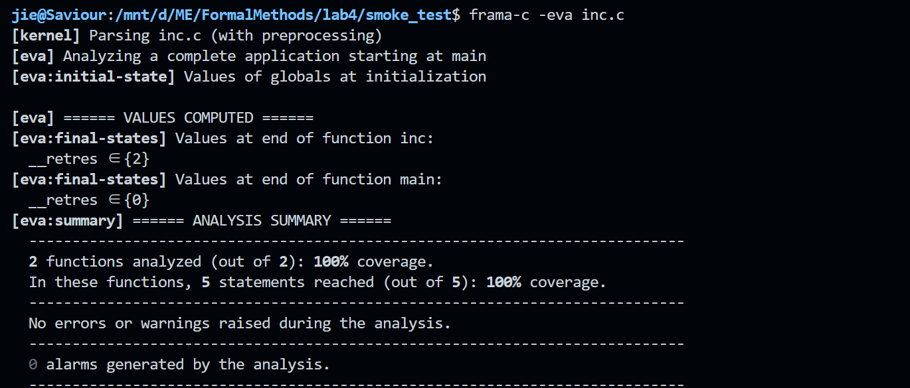
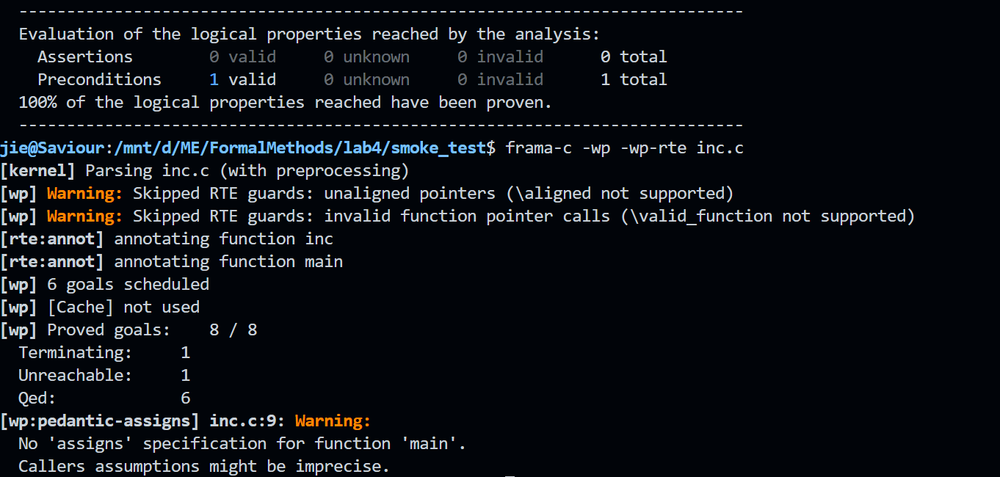

<!-- 环境正确时，Eva 不应报告由该程序产生的运行时告警；WP 应生成证明义务，并把简单算术性质证明为有效。若外部证明器未配置，应至少看到由内置化简器完成的目标和明确的未证明目标，而不是插件缺失错误。 -->


### 4.2 Rocq

保存以下文件为 `rocq_smoke.v`：

```coq
From Stdlib Require Import List Arith Lia.
Theorem plus_zero : forall n : nat, n + 0 = n.
Proof.
  intros n.
  induction n; simpl; auto.
Qed.
```

在已配置的终端中查看版本并编译文件：

```sh
rocq -v
rocq compile rocq_smoke.v
```

运行结果：
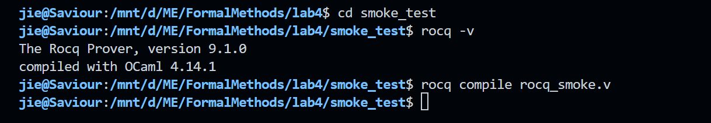
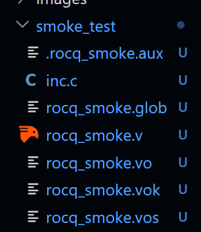

<!-- 环境正确时，版本信息正常显示，文件编译通过，且没有标准库加载失败、未完成证明或语法错误。随后在所配置的编辑器中打开同一文件，逐步执行证明，确认能够查看当前目标和假设。 -->

## 5. 实验任务

### 任务 1：为区间截断函数编写并检查契约

**任务摘要：** 从自然语言要求中提取前置条件和分情况后置条件，为下面给出的 C 函数编写 ACSL 契约并检查契约能否发现实现错误。

保存以下实现为 `clamp_value.c`：

```c
int clamp_value(int x, int low, int high) {
    if (x < low) {
        return low;
    }
    if (x > high) {
        return high;
    }
    return x;
}
```

自然语言要求如下：

- 调用时保证 `low <= high`。
- 当 `x < low` 时返回 `low`；当 `x > high` 时返回 `high`；否则返回 `x`。

#### 5.1.1. 建立一张“输入区域—预期返回值”表，区分 `x < low`、`low <= x <= high` 和 `x > high`，并说明两个端点属于哪个区域

|输入区域|预期返回值|
|:-:|:-:|
|`x < low`|`low`|
|`low <= x <= high`|`x`|
|`x > high`|`high`|

*说明：* low与high这两个端点属于`low <= x <= high`。

#### 5.1.2. 编写包含 `requires`、`assigns` 和分情况 `ensures` 的 ACSL 契约，使其准确表达上述要求；不得通过增加与需求无关的前置条件排除某一输入区域

ACSL契约：
`requires`:调用函数之前必须保证`low <= high`
`assigns`:因为函数没有修改指针指向的内容或全局变量，所以无
分情况`ensures`:有三种情况
最后编写情况如下：
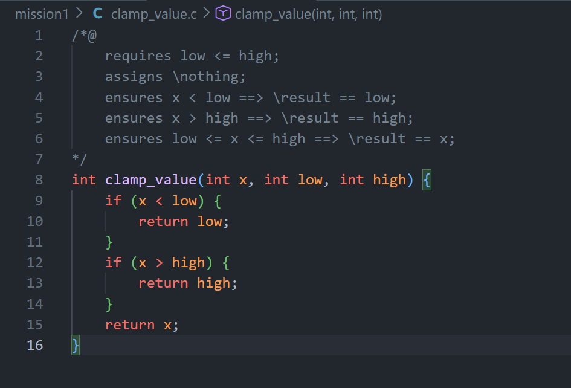

#### 5.1.3. 使用 `frama-c -wp -wp-rte clamp_value.c` 验证，并把每一组后置条件对应到程序中的一个返回分支

验证结果如下：
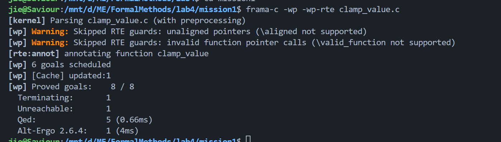

后置条件：

- `ensures x < low ==> \result == low;`对应：
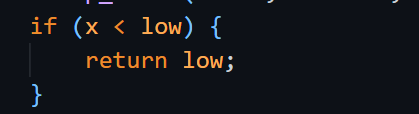
- `ensures x > high ==> \result == high;`对应：
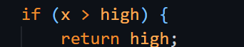
- `ensures low <= x <= high ==> \result == x;`对应：


#### 5.1.4. 复制一份错误版本，把 `x > high` 分支的返回值改为 `low`。使用同一契约检查错误版本，指出失败的证明义务对应哪条自然语言要求

验证结果如下：
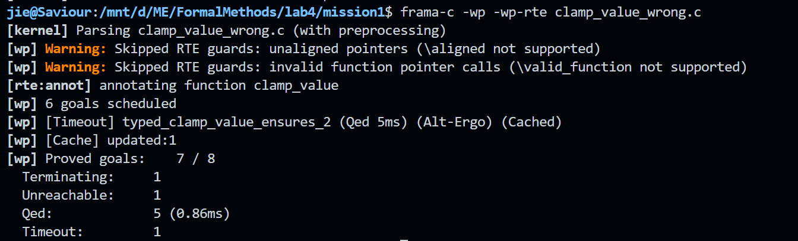

根据` [Timeout] typed_clamp_value_ensures_2 (Qed 5ms) (Alt-Ergo) (Cached)`可以看出失败的证明义务是第二条`ensures x > high ==> \result == high;`，即当 `x > high` 时返回 `high`。

#### 5.1.5. 对契约如何区分正确实现和错误实现自行撰写的结论

对于所有满足`requires`的合法调用，若都满足`ensures`且不违反`assigns`则为相对该契约的正确实现，而只要存在一个合法输入使某条`ensures`失败则为错误实现。

<!-- **实验报告应包含：** 输入区域表、完整 ACSL 契约、正确版本和错误版本的 WP 结果，以及失败证明义务与需求的对应；正确与错误版本关键证明结果的截图；以及你对契约如何区分正确实现和错误实现自行撰写的结论。 -->

### 任务 2：内存有效性与副作用边界

**任务摘要：** 为固定的数组写入函数补充下标范围、内存有效性和副作用约束，说明每条契约为什么是合法访问所必需的。

保存以下程序为 `write_at.c`：

```c
#include <stddef.h>
/*@
  ensures a[index] == value;
*/
void write_at(int *a, size_t n, size_t index, int value) {
    a[index] = value;
}
```

#### 5.2.1. 保持初始契约不变，运行 `frama-c -wp -wp-rte write_at.c`，记录与 `a[index]` 的合法读写有关的未证明目标，并说明仅有功能后置条件为什么不足以保证内存安全。

运行结果：
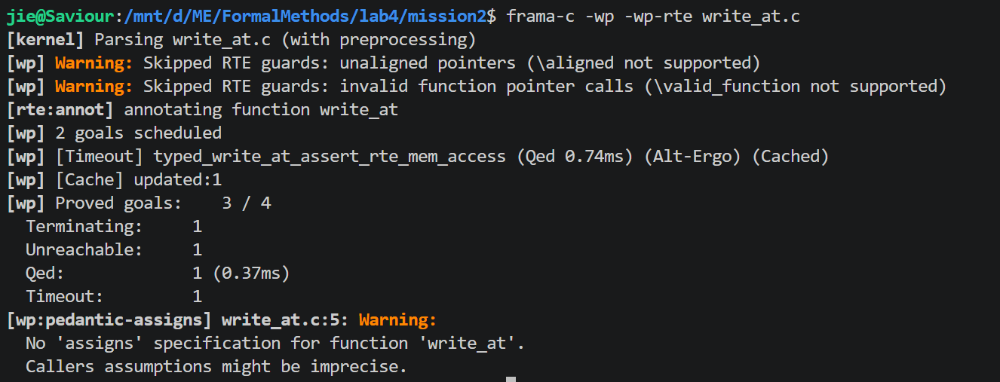

- 可以看到，本次验证4个证明目标，3个证明成功，1个未能证明。
- 未证明的目标是`typed_write_at_assert_rte_mem_access`，它与语句`a[index] = value`的内存访问安全有关。
- 初始契约只有功能后置条件`ensures a[index] == value;`，没有通过前置条件保证`a[index]`指向合法且可写的内存，因此WP无法证明该读写操作是安全的。
- 此外，Frama-C还报告了缺少`assigns`子句的警告。没有`assigns`时，契约没有明确限制函数允许修改的内存范围，调用者无法仅根据契约得知函数只修改了`a[index]`。
- 因此，功能后置条件只能描述函数执行后的结果，不能代替内存有效性条件和副作用约束。

#### 5.2.2. 补充 `index < n`、数组区间 `a + (0 .. n-1)` 可写和 `assigns a[index]`，重新验证。逐条说明这些条件分别限制了什么调用或副作用。

补充后：
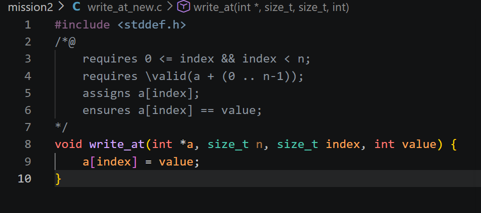
重新验证结果：
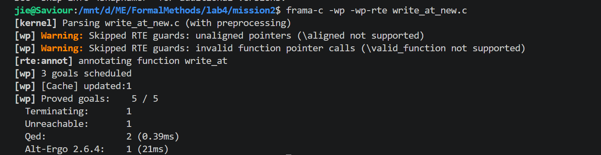

- 第一条requires限制了`index`范围只能取到从`0`到`n-1`的值
- 第二条前置条件则保证整段内存合法且可写
- `assigns`表示函数只允许修改`a[index]`

#### 5.2.3. 把整段数组有效性条件替换为只要求 `a + index` 指向一个可写元素，再次验证。比较两种写法：哪一种更准确地描述本函数实际访问的内存，哪一种向调用者要求了更完整的数组区域。

把`requires \valid(a + (0 .. n-1));`换成`requires \valid(a + index);`后：
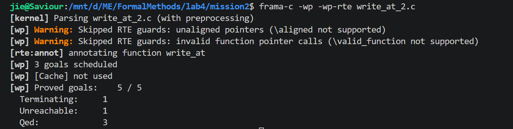

因为函数只访问了`a[index]`，所以新的版本（`a + index`）更能准确地描述函数真正需要的内存，而之前的（`a + (0 .. n-1)`）则要求了更完整的数组区域，因为即使函数不会访问其他元素，也要求从`a[0]`到`a[n-1]`全部合法可写。

#### 5.2.4. 分别删除 `index < n` 和 `assigns a[index]` 后重新检查，记录证明结果或契约含义的变化；恢复最终契约。

分别记作`write_at_3.c`与`write_at_4.c`，重新检查结果如下：

- `write_at_3.c`:
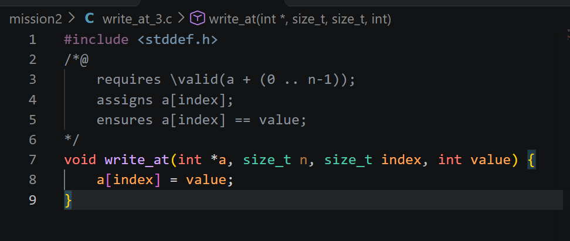
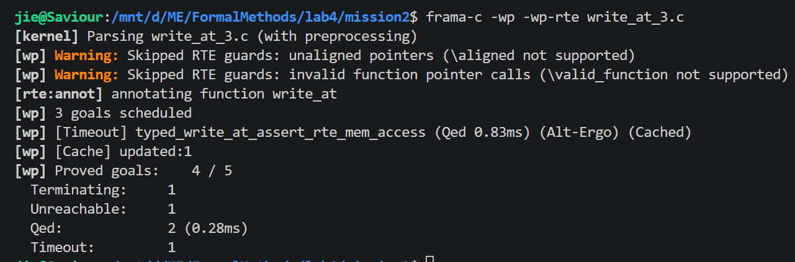
删除 `index < n` 后，Frama-C只能证明5个目标中的4个，未证明目标是`typed_write_at_assert_rte_mem_access`。以及，虽然契约保证了`a[0]`到`a[n-1]`的内存有效，但无法保`index`位于该范围内，因此不能证明内存的读写安全。

- `write_at_4.c`:
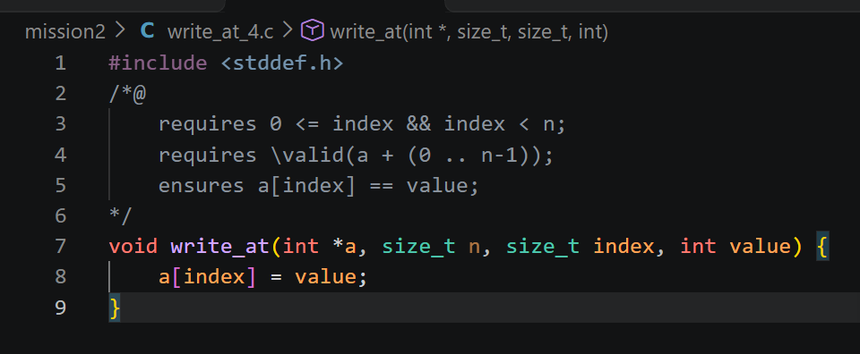
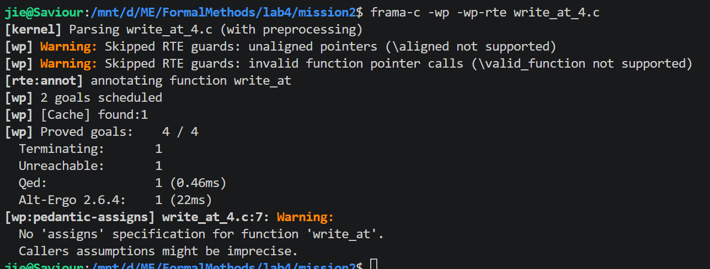
删除`assigns a[index]`后，报告显示缺少`assigns`子句，因为契约不再明确限制函数允许修改的内存范围。

由此可见，`index < n`用于约束下标范围，而`assigns a[index]`用于约束函数的副作用，两者作用不同。

*恢复最终契约：只需要用`write_at_new.c`即可*

#### 5.2.5. 对内存有效性条件和 `assigns` 分别说明什么自行撰写的结论

- 内存有效性条件：
  `\valid`用于说明哪些内存可以安全访问，从而保证函数不会产生无效内存访问，所以缺少内存有效性条件会导致无法证明内存访问安全目标。
- `assigns`：
  `assigns`则说明函数被允许修改哪些内存，若缺少，功能和内存安全目标仍可能通过，但契约不能向调用者准确保证函数的修改范围。

<!-- **实验报告应包含：** 初始代码、最终 ACSL 契约、补充前后的证明结果、整段数组与单个元素两种有效性条件的比较，以及删除范围或副作用约束后的结果；关键证明义务的截图；以及你对内存有效性条件和 `assigns` 分别说明什么自行撰写的结论。 -->

### 任务 3：循环不变式与变式

**任务摘要：** 逐步为循环补充索引范围、计数范围和终止度量，观察每一条信息对应哪些证明义务。

保存以下程序为 `count_nonzero.c`：

```c
#include <limits.h>
#include <stddef.h>
/*@
  requires n == 0 || \valid_read(a + (0 .. n-1));
  requires n <= INT_MAX;
  assigns \nothing;
  ensures 0 <= \result <= n;
*/
int count_nonzero(const int *a, size_t n) {
    size_t i = 0;
    int count = 0;
    while (i < n) {
        if (a[i] != 0) {
            ++count;
        }
        ++i;
    }
    return count;
}
```

#### 5.3.1. 说明前置条件 `n <= INT_MAX` 为什么使 `int count` 和 `int` 返回值能够容纳最大可能计数；再为 `count_nonzero.c` 依次添加 `0 <= i <= n`、`0 <= count <= i` 和 `loop assigns i, count`。说明“已处理元素数为 `i`”为什么能够支持 `count <= i`

1. `count`是`int`型，而`n`是`size_t`类型。`size_t`能表示的非负数范围比`int`大。极端情况下，`n`可能大于`INT_MAX`。假设全部元素均非零，则`count`最终的值会超出`INT_MAX`，所以需要规定前置条件`n <= INT_MAX`，从而由`count <= i <= n`得到`count <= INT_MAX`，所以`int count`和`int`返回值能够容纳最大可能计数。

2. 为 `count_nonzero.c` 依次添加 `0 <= i <= n`、`0 <= count <= i` 和 `loop assigns i, count`，分别记为：`count_nonzero1.c`，`count_nonzero2.c`和`count_nonzero3.c`。
   - `i`表示已经处理的元素数量。`a[0]`到`a[i-1]`表示已经处理的元素。每个元素最多使`count`增加一次，因此非零元素的计数不会超过已处理元素的数量，即`count <= i`。
   - 索引不变式 `0 <= i <= n` 约束访问范围，计数不变式 `0 <= count <= i` 约束计数范围，而 `loop assigns i, count` 说明循环只修改索引和计数变量，不修改输入数组。

#### 5.3.2. 每次只添加上一步中的一项并重新运行 WP，记录它帮助证明了哪个范围或退出目标，不得直接粘贴最终版本

1. 初始，运行`count_nonzero.c`：
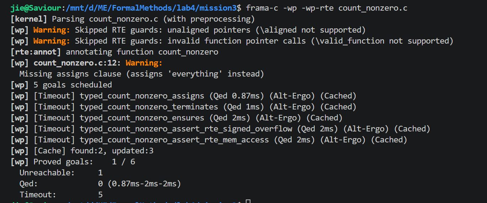

2. 运行`count_nonzero1.c`：
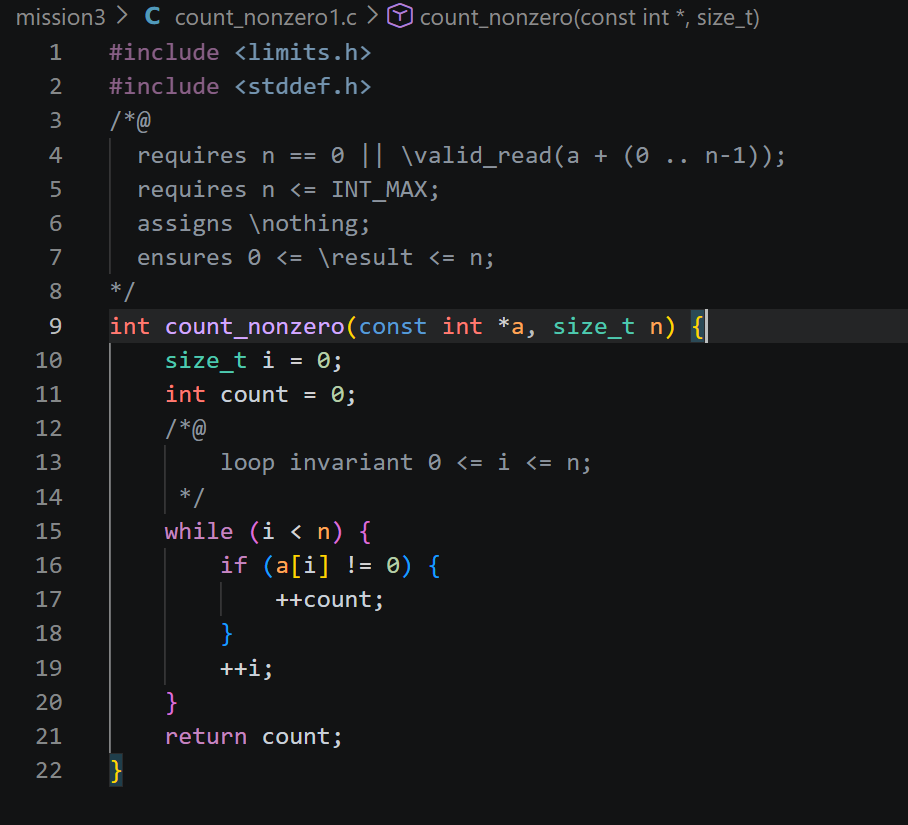
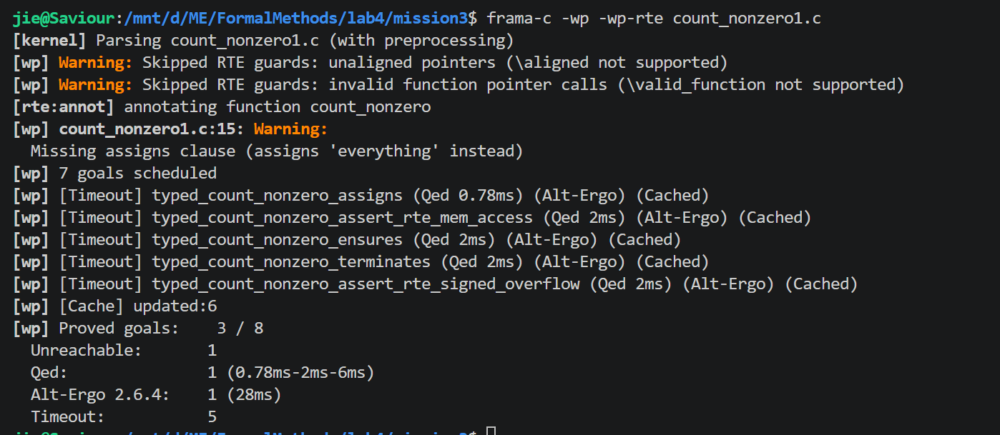
只添加索引不变式`0 <= i <= n`后，`Frama-C`证明了8个目标中的3个。该不变式帮助证明了循环索引的范围信息。

3. `count_nonzero2.c`：
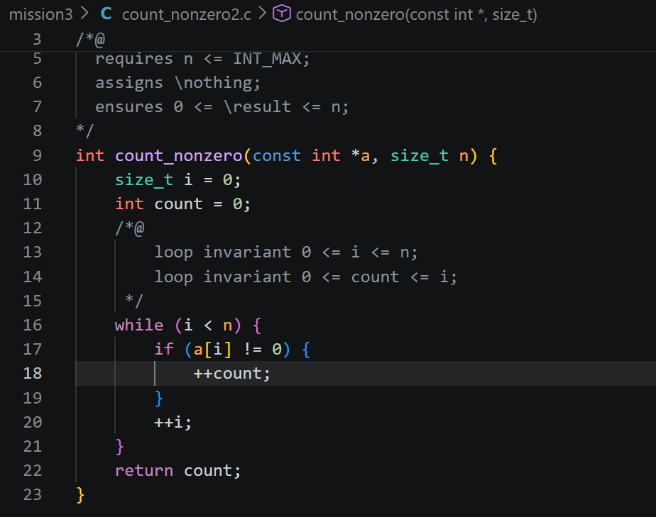
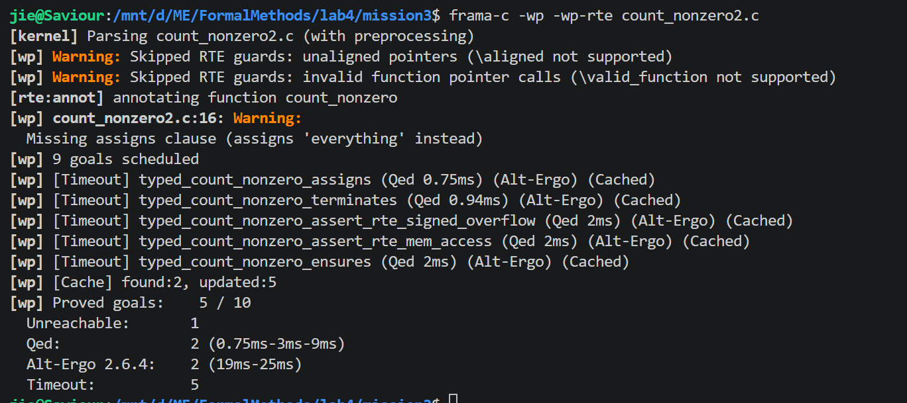
继续添加`0 <= count <= i`后，帮助证明了5/10个目标和`count <= i <= n <= INT_MAX`的关系，为证明计数不会溢出以及最终结果不超过`n`提供了必要信息。

4. `count_nonzero3.c`：
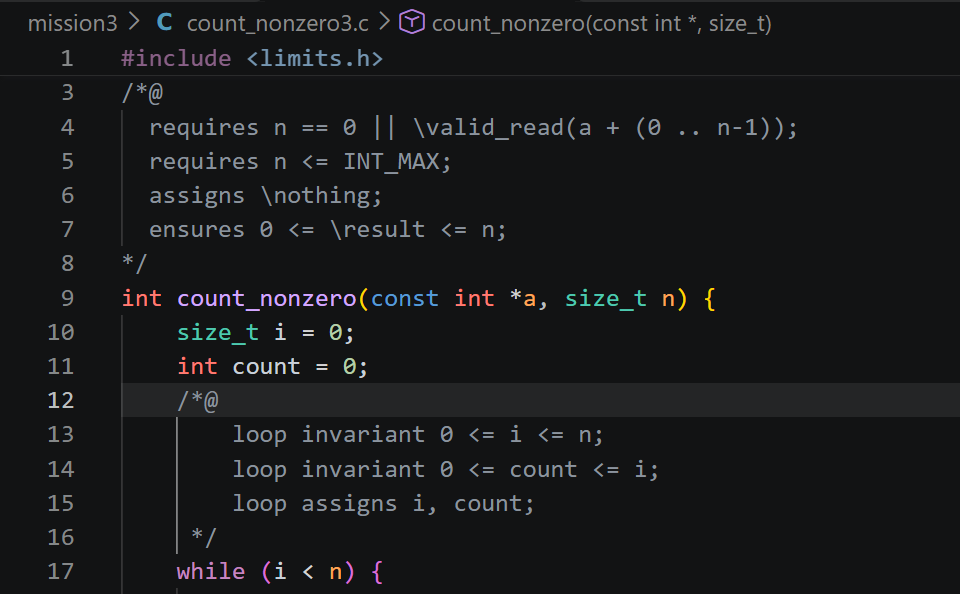
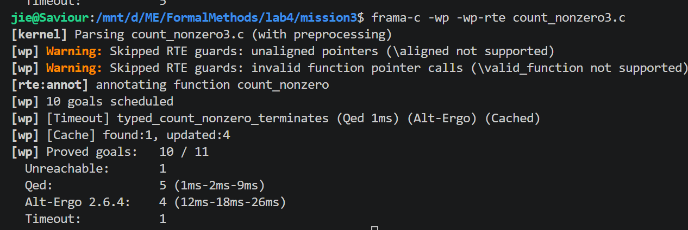
继续添加`loop assigns i, count`后，证明了10/11个目标，只剩终止性目标未证明，该子句限制循环只能修改`i`和`count`，在循环过程中保持数组、指针和参数`n`的相关性质不变。

#### 5.3.3. 添加 `loop variant` 证明终止。然后删除或削弱一条关键不变式，观察哪个证明目标再次失败，并解释该不变式提供了什么信息

1. 添加`loop variant`：
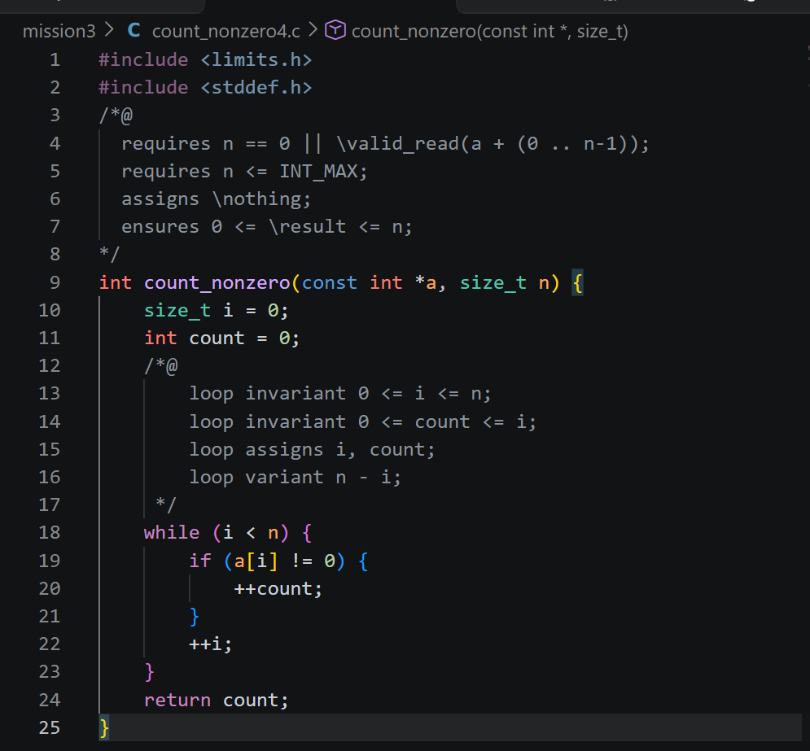
验证结果：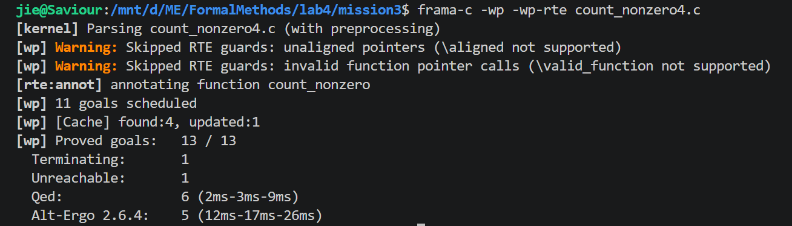
2. 这里选择删除关键不变式`loop invariant 0 <= count <= i;`：
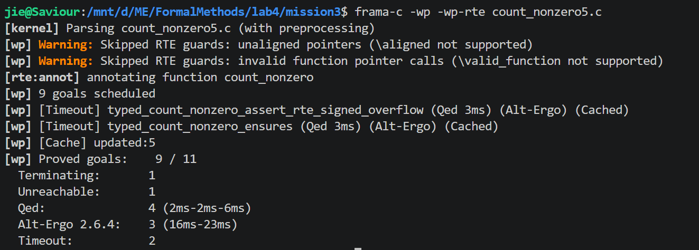
    - 可以看到：添加`loop variant n - i`后，`Frama-C`成功证明了全部13个目标，其中包括1个终止性目标。而删除计数不变式`0 <= count <= i`后，验证结果变为11个目标中证明9个，未证明目标分别为`typed_count_nonzero_assert_rte_signed_overflow`和`typed_count_nonzero_ensures`。因为删除后验证器无法得到`count <= i <= n <= INT_MAX`，因此不能证明`++count`不会导致有符号整数溢出，也不能证明最终返回值满足`0 <= \result <= n`。
    - 这说明不变式`0 <= count <= i`提供了`i`与`count`之间的联系信息。

#### 5.3.4. 你对输入范围、索引范围、计数范围和终止度量各自作用自行撰写的结论

- **输入范围**：限制输入数据的大小，保证后续的计算过程和最终结果不会超出变量类型能存的最大值，防止发生数据溢出。
- **索引范围**：限制循环变量的取值范围，保证不越界的同时完整处理了所有遍历数据。
- **计数范围**：限制用作计数大小，保证计数在合理的预期范围内，不会超出边界。
- **终止度量**：证明程序不会无限循环，保证程序的终止性。

<!-- **实验报告应包含：** `n <= INT_MAX` 与计数类型的关系、三项循环注解逐步添加的记录、最终不变式与 `loop variant`、删除一条关键不变式后的失败结果；关键失败与成功证明状态的截图；以及你对输入范围、索引范围、计数范围和终止度量各自作用自行撰写的结论。 -->

### 任务 4：Eva 告警与数值边界

**任务摘要：** 在固定数组累加程序上依次缩小长度和值域，观察 Eva 的内存与溢出告警如何变化，再与 WP 对同一边界性质的证明进行比较。

保存以下程序为 `eva_sum.c`：

```c
#include "__fc_builtin.h"
int sum_prefix(const int *a, unsigned n) {
    int sum = 0;
    for (unsigned i = 0; i < n; ++i) {
        sum += a[i];
    }
    return sum;
}
int main(void) {
    int a[8];
    for (unsigned i = 0; i < 8; ++i) {
        a[i] = Frama_C_interval(-1000000000, 1000000000);
    }
    unsigned n = (unsigned)Frama_C_interval(0, 12);
    return sum_prefix(a, n);
}
```

#### 5.4.1. 运行 `frama-c -eva -eva-slevel 20 eva_sum.c`，把告警分为数组访问、整数溢出和分析精度信息，并指出产生每类告警的输入范围

运行结果：
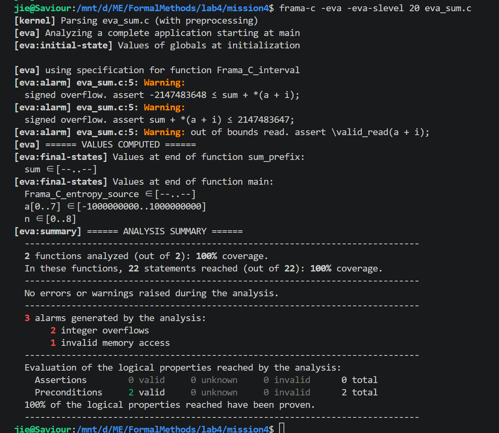

- 数组访问：
    `Warning: out of bounds read. assert \valid_read(a + i);`
    > 数组的合法下标为`0..7`，当`n ∈ [9,12]`时可能发生数组越界
- 整数溢出：
    `Warning:signed overflow. assert -2147483648 ≤ sum + *(a + i);`
    `Warning:signed overflow. assert sum + *(a + i) ≤ 2147483647;`
    > 因为`a[i] ∈ (-1000000000,1000000000)`，而`sum`却是`int`型，当连续累加较大的正数或负数时，结果可能超出32位有符号整数的表示范围。（比如`n = 3`且前三个元素均为1000000000时，累加结果会超过`INT_MAX`；若均为-1000000000，则会低于`INT_MIN`）
- 分析精度信息：
    `sum ∈ [--..--]`
    `Frama_C_entropy_source ∈ [--..--]`
    `a[0..7] ∈ [-1000000000..1000000000]`
    `n ∈ [0..8]`
    > Eva输出中的变量取值范围和分析状态信息反映的是抽象解释得到的结果，并不是额外的运行时错误告警。其主要用于说明分析结果的不确定性，而不是指出某个确定会产生错误的输入

#### 5.4.2. 只把 `n` 的范围从 `0..12` 改为 `0..8`，重新运行并比较数组访问告警；其它部分保持不变

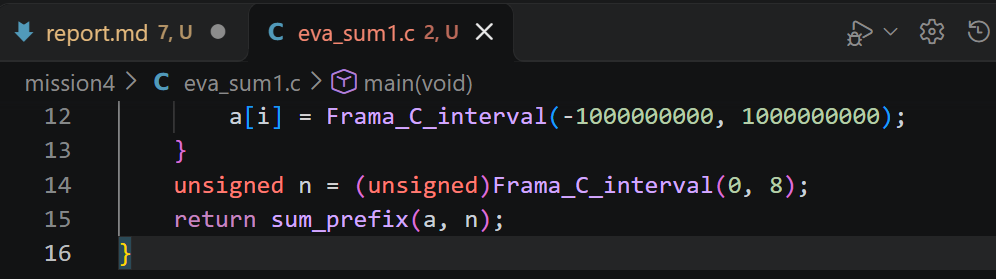
运行结果：
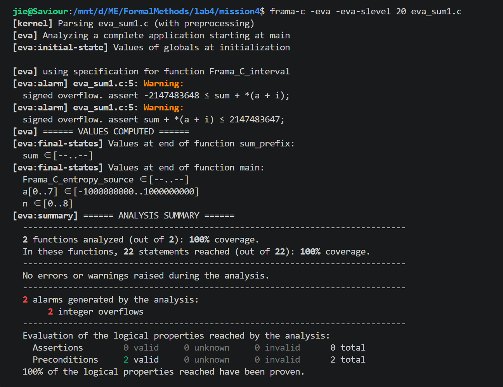

可以发现，这次不再有数组访问的告警：`Warning: out of bounds read. assert \valid_read(a + i);`

#### 5.4.3. 在长度已经限制为 `0..8` 的版本中，只把数组元素范围改为 `-100..100`，重新运行并比较整数溢出告警。说明最终结论依赖哪两个输入范围

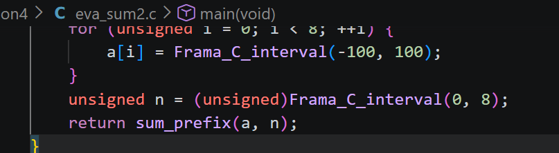
运行结果：
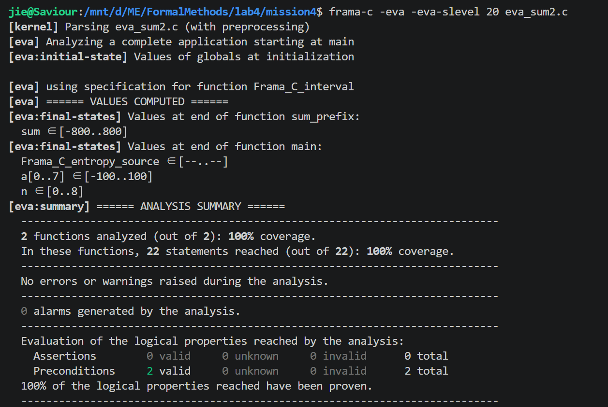

可以看到，这次不再有整数溢出等任何告警信息。
所以，最终结论依赖以下两个输入范围：

- 数组长度范围：**`n ∈ [0,8]`**，保证循环不会访问数组有效范围之外的元素。
- 数组元素范围：**`a[i] ∈ [-100,100]`**，保证累加过程中不会发生有符号整数溢出。

#### 5.4.4. 为 `sum_prefix` 单独建立 `wp_sum.c`：用契约要求 `n <= 8`、访问区间可读且每个参与累加的元素位于 `-100..100`，用后置条件要求结果位于 `-800..800`；循环中使用 `0 <= i <= n` 和 `-100 * i <= sum <= 100 * i`。运行 `frama-c -wp -wp-rte wp_sum.c`，比较 Eva 在固定入口范围下不再告警与 WP 在契约前提下证明结果边界分别能说明什么

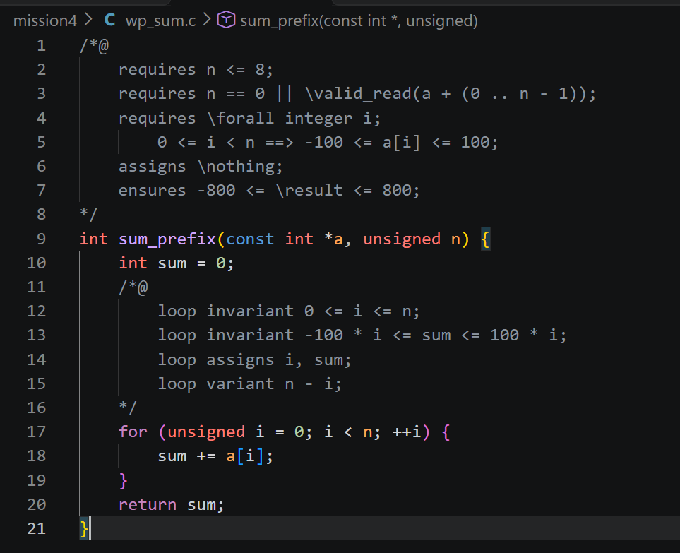
验证结果：
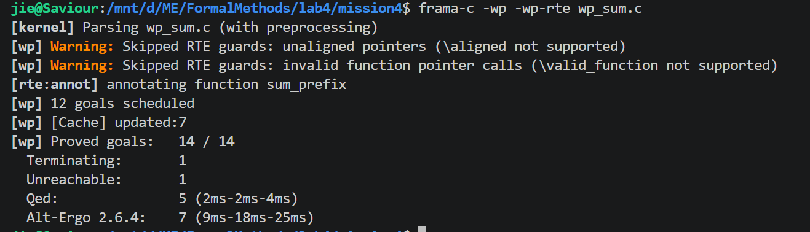

**Eva 与 WP 的比较**：

- Eva在固定入口范围下不再产生告警，说明其主要通过抽象解释来检查可能存在的运行时错误。
- WP在契约前提下证明结果边界，说明其通过证明义务验证程序是否满足指定规约。

#### 5.4.5. 你对“Eva 告警消失、WP 证明成功和业务需求正确为什么不是同一件事”自行撰写的结论

> - **Eva告警消失**说明在当前输入范围下没有发现相关的运行时错误；
> - **WP证明成功**说明程序在满足前置条件时，能够达到规约要求。
> - 但这两者都不能直接说明程序符合实际业务需求，因为规约本身也可能不完整或者存在错误。
<!-- **实验报告应包含：** 固定程序、三组 Eva 输入范围和告警对照、最终 `wp_sum.c` 契约与循环不变式、WP 结果，以及两种工具结论的前提；关键告警变化和证明结果的截图；以及你对“Eva 告警消失、WP 证明成功和业务需求正确为什么不是同一件事”自行撰写的结论。 -->

### 任务 5：规约变异与非空洞性

**任务摘要：** 修改 `sign_of` 的规约并比较验证结果，理解“证明成功”为什么不一定表示规约完整表达了需求。

规约变异（specification mutation）是指每次只修改一处规约，再观察验证结果如何变化。

下面的 `sign_of` 函数在输入为负数、零和正数时，应分别返回 `-1`、`0` 和 `1`。将其保存为 `sign_of.c`：

```c
/*@
  assigns \nothing;
  ensures x < 0  ==> \result == -1;
  ensures x == 0 ==> \result == 0;
  ensures x > 0  ==> \result == 1;
*/
int sign_of(int x) {
    if (x < 0) {
        return -1;
    }
    if (x > 0) {
        return 1;
    }
    return 0;
}
```

以下三种变异互相独立。开始下一种变异前，恢复上面的程序和规约。每次运行后，都应把发生变化的证明义务对应到本次唯一修改的规约或程序位置。-> **这里我每次都新建一个文件用于记录每一次的更改步骤**

#### 5.5.1. **检查原始规约：** 运行 `frama-c -wp -wp-rte -wp-fct sign_of sign_of.c`，确认三条分情况后置条件均得到证明，并把每条成功的证明义务对应到负数、零或正数输入区域

运行结果：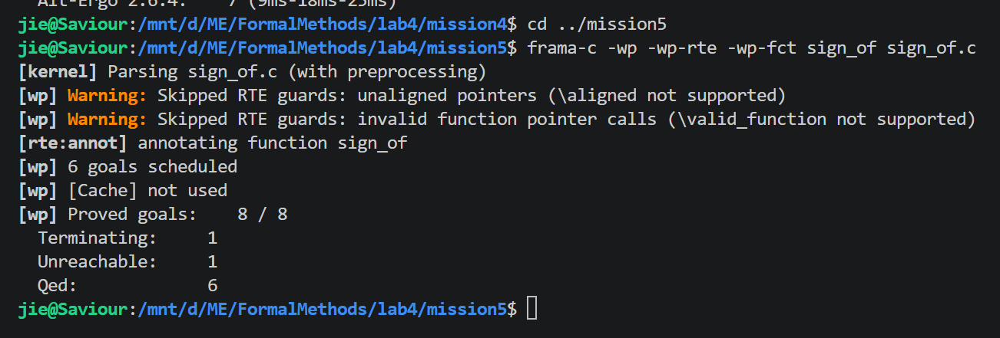
Proved goals：8/8,所以三条分情况后置均得到证明：

| ACSL 后置条件 | 输入范围 | 对应程序分支 | 返回值 |
| --- | --- | --- | --- |
| ensures x < 0 ==> \result == -1; | 负数：x < 0 | if (x < 0) | -1 |
| ensures x == 0 ==> \result == 0; | 零：x == 0 | 最后的 return 0; | 0 |
| ensures x > 0 ==> \result == 1; | 正数：x > 0 | if (x > 0) | 1 |

#### 5.5.2. **削弱后置条件：** 将三条 `ensures` 替换为 `ensures -1 <= \result && \result <= 1;`，运行 WP。然后把函数改成始终返回 `0`，使用同一规约再次检查。解释错误实现为什么仍能通过，以及弱规约遗漏了什么要求

1. 新增`sign_of1.c`：
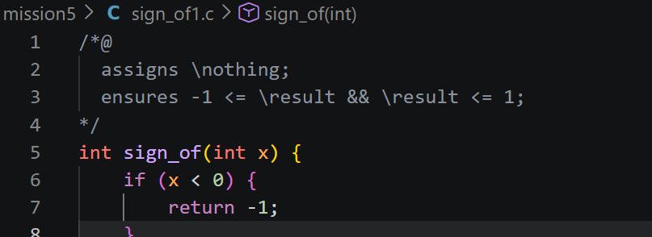
检查结果：
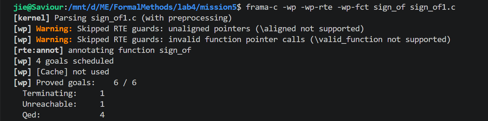
因为新的规约只要求`\result`在[-1,1]内，却没有要求不同输入必须返回对应的结果，所以错误实现仍能通过。

2. 新增`sign_of1_1.c`：
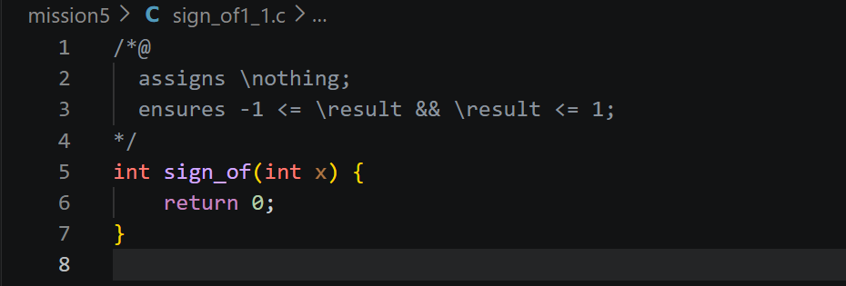
检查结果：
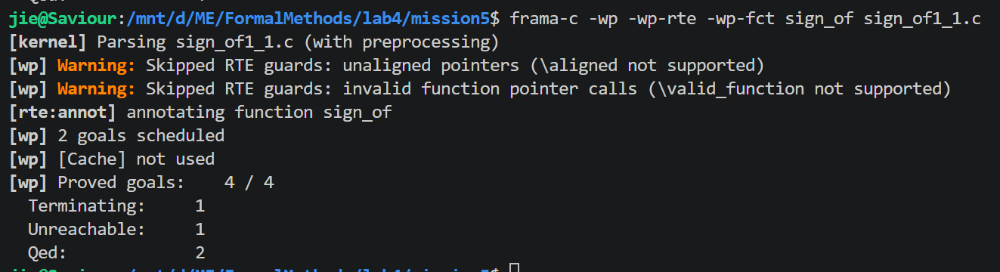
因为函数改成始终返回`0`，所以依旧能满足`\result`在[-1,1]内（`ensures -1 <= \result && \result <= 1;`），所以错误实现仍能通过。

3. 弱规约只限制返回值必须位于[-1,1]，没有规定负数、零和正数输入分别应该返回什么。

#### 5.5.3. **收紧前置条件：** 在原始规约中增加 `requires x != 0;`，检查 `sign_of`。然后在文件末尾增加 `int main(void) { return sign_of(0); }`，运行 `frama-c -wp -wp-rte -wp-fct main sign_of.c`。解释函数本身能够通过、零值调用却失败的原因

新增`sign_of2.c`：
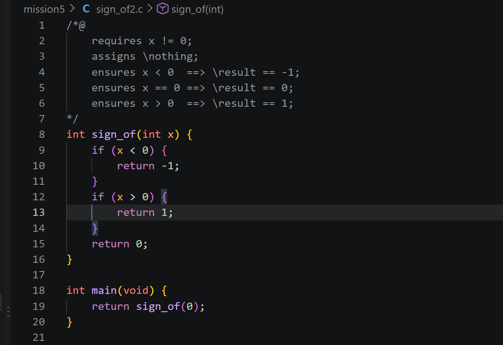

- 检查`sign_of`：
  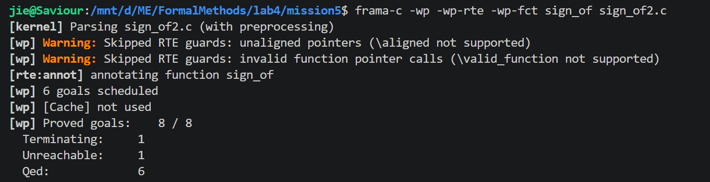
- 检查`main`：
  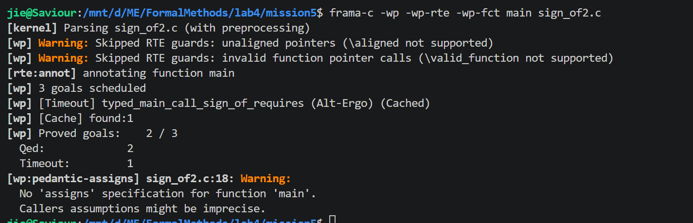

**函数本身能够通过、零值调用却失败的原因**:

> - 因为WP验证函数时只考虑满足前置条件的输入，即只需要验证`x < 0`和`x > 0`两种情况。输入`x == 0`已被前置条件排除，所以函数本身能通过。
> - 但是零值调用却失败了，未证明目标是`typed_main_call_sign_of_requires`，这是因为它要求调用点满足`sign_of`的前置条件`x != 0`。然而调用时实参为0，证明条件变为`0 != 0`，不成立。

#### 5.5.4. **错写边界：** 将原始规约第一条后置条件中的 `x < 0` 改成 `x <= 0`，运行 WP。说明输入为 `0` 时，哪两条后置条件提出了不同要求

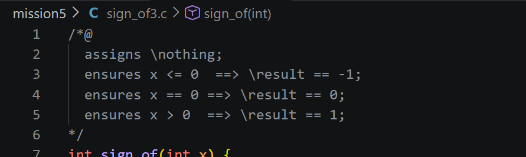
运行结果：
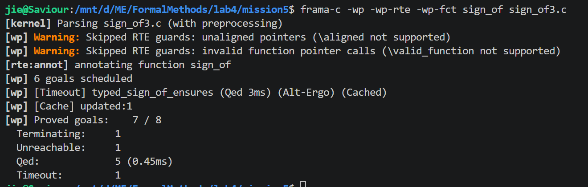

输入为 `0` 时，后置条件`x <= 0 ==> \result == -1`要求返回值为-1；而`x == 0 ==> \result == 0`要求返回值为0，提出了不同的要求。

#### 5.5.5.你对“证明成功为什么不一定表示规约完整表达了需求”自行撰写的结论

> 因为WP证明成功只能说明程序满足当前编写的规约，而当前的规约不一定能完整正确地表达实际需求。如果规约遗漏了某些输入情况下的要求，即使程序存在错误，也可能通过验证。

<!-- **实验报告应包含：** 原始规约和三种变异、每次实际 WP 结果、发生变化的证明义务及其与修改位置的对应；原始规约成功、弱规约下错误实现仍成功、零值调用失败和错误边界失败的关键截图；以及你对“证明成功为什么不一定表示规约完整表达了需求”自行撰写的结论。 -->

### 任务 6：Rocq 小型交互证明

**任务摘要：** 在 Rocq 中证明过滤后的列表长度不超过原列表长度，观察归纳证明状态，并比较显式证明与较短的自动化证明。

保存以下文件为 `filter_length.v`：

```coq
From Stdlib Require Import List Arith Lia.
Import ListNotations.
Theorem filter_length_le :
  forall (A : Type) (keep : A -> bool) (xs : list A),
    length (filter keep xs) <= length xs.
Proof.
  intros A keep xs.
  induction xs as [| x xs IH].
  - (* 空列表情形 *)
    admit.
  - (* 非空列表情形 *)
    simpl.
    destruct (keep x) eqn:Hkeep.
    + admit.
    + admit.
Qed.
```

#### 5.6.1. 不使用 `Admitted` 或其它未完成证明占位，补全三个 `admit`，使文件能够通过 `rocq compile filter_length.v` 检查

归纳证明首先将列表分为空列表和非空列表两种情况：

- 对于空列表，使用`simpl`将目标化简为`0 <= 0`，再通过`lia`完成证明。
- 对于非空列表，使用`destruct`根据`keep x`的结果分为保留和丢弃当前元素两种情况，然后在这两个分支中，先使用`simpl`化简表达式，再通过`lia`利用归纳假设`IH`证明定理。

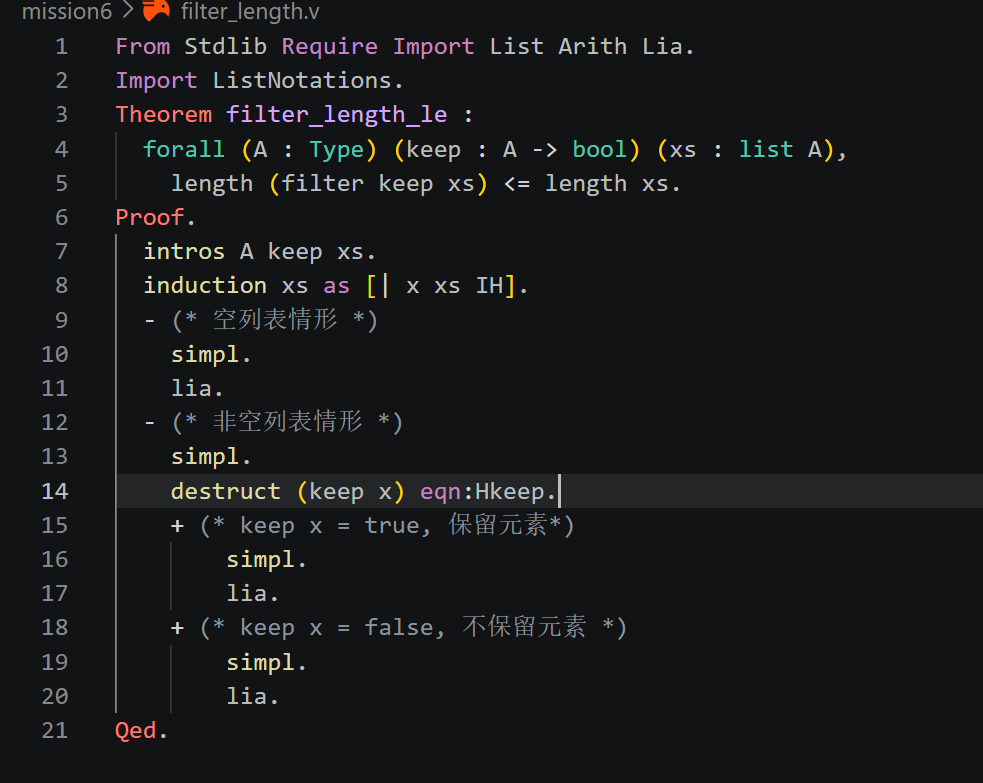
检查结果：
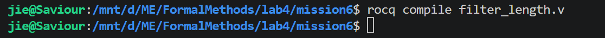
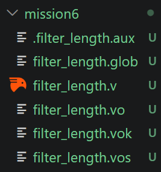

#### 5.6.2. 在执行列表归纳后和对 `keep x` 分情况后，各保留一个中间证明状态，解释归纳假设、当前目标和下一步为什么可以使用算术自动化

1. 执行列表归纳后：
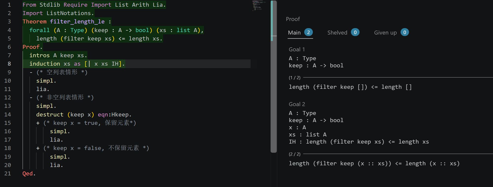

- **归纳假设**：在非空列表分支中，`IH : length (filter keep xs) <= length xs`，表示剩余列表xs筛选后的长度不超过原长度
- **当前目标**：证明空列表和非空列表两种情况下，筛选后的长度都不超过原长度，`length (filter keep []) <= length []`，`length (filter keep (x :: xs)) <= length (x :: xs)`
- **下一步为什么可以使用算术自动化**：空列表可以通过`simpl`化简为`0 <= 0`，再使用`lia`完成证明；非空列表则需要进一步分类讨论

2. 对 `keep x` 分情况后：
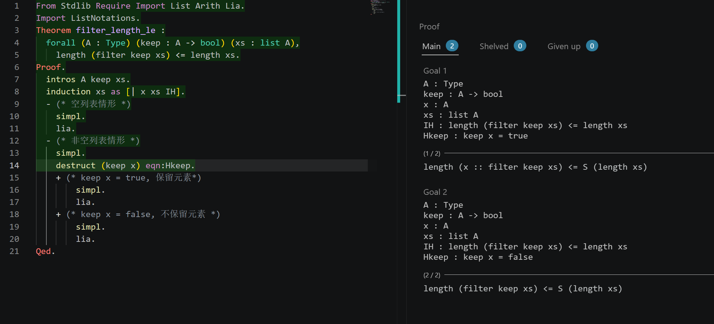

- **归纳假设**：`length (filter keep xs) <= length xs`，表示剩余列表xs满足长度不增加的性质。
- **当前目标**：分别证明`keep x = true`和`keep x = false`时，筛选后的长度不超过原长度。
- **下一步为什么可以使用算术自动化**：保留元素时，两边长度都增加1；丢弃元素时则只有原列表长度增加1。通过`simpl`化简后，均可利用`IH`和`lia`完成证明。

#### 5.6.3. 在同一文件中以 `filter_length_le_short` 为名称写出同一结论的第二份证明，允许组合使用 `induction`、`simpl`、`destruct`、`auto` 或 `lia` 缩短脚本；比较两种脚本中结构是否清楚、自动化依赖是否明显

这里使用`;`将多个证明步骤组合起来，减少了重复代码：
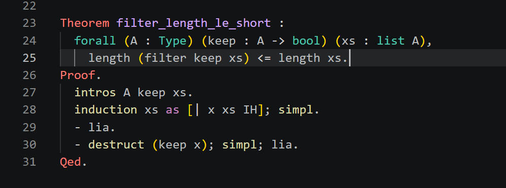

此外，两种证明都使用`induction`进行列表归纳，使用`destruct`分类讨论，并通过`lia`完成算术证明：

- 原始证明将每个分支分别展开，结构更加清楚，便于理解和观察中间证明状态；
- 简短证明则合并了重复步骤，代码更加简洁，但具体的证明过程不如原始版本直观。
- 两者的证明思路和使用的自动化策略基本相同。

#### 5.6.4. 把结论临时改成严格不等式 `<`。在尝试修改证明脚本前，先判断新结论是否对所有列表成立；如果不成立，给出规模最小的具体输入并计算等式两侧的值。再重新编译，用该输入判断失败来自定理陈述还是证明策略；最后恢复正确结论

改为`length (filter keep xs) < length xs.`后，意味着再过滤筛选之后，必须至少删除一个元素，这很显然命题不再成立，因为filter不一定会删除元素。

取最小规模的具体输入为例子：`xs = []`，假设取`A = nat`，`keep = fun x : nat => true`，最后得到的是`0 < 0`，这显然不成立。

**重新编译结果**；


查看中间证明状态：

> 取规模最小的反例`A = nat`、`xs = []`，`keep`为始终返回`true`的函数。此时筛选前后列表长度均为0，严格不等式变成 `0 < 0`，显然不成立。
> 因此，证明失败是由于**定理陈述**，而不是证明策略。

#### 5.6.5.你对如何区分“命题为假”和“证明策略不足”自行撰写的结论

> - 当证明失败时，需要先判断命题本身是否成立。如果能找到具体反例就说明命题为假。
> - 如果实在没有发现反例，则可能是当前证明策略不足，需要尝试其他方法。

<!-- **实验报告应包含：** 两份可检查的证明脚本、归纳后和分情况后的中间目标、两种策略对照，以及严格不等式版本的失败和你找到的最小反例；证明完成与中间目标的截图；以及你对如何区分“命题为假”和“证明策略不足”自行撰写的结论。 -->

### 任务 7：验证 LLM 生成的小型 C 程序

**任务摘要：** 先独立写清一个小型 C 函数的需求，再让 LLM 生成实现，最后用你自己编写的 ACSL 契约和 Frama-C 检查该实现。

#### 5.7.1. 从数值计算、区间映射、数组统计或边界检查中选择一个 10—25 行的 C 函数，先独立写出三条明确需求，其中至少一条涉及边界情况

这里选择**数值计算**函数`manhattan_distance(int x1, int y1, int x2, int y2)`，用于计算平面上两点的曼哈顿距离。

**三条需求：**

1. **基本功能**： 接收两个点的整数坐标(x1, y1)和(x2, y2)，按照|x1-x2|+|y1-y2|计算并返回曼哈顿距离。
2. **特殊情况**： 当两个点重合时，返回0；交换两个点的输入顺序，不应改变计算结果。
3. **边界情况**： 四个坐标值均位于[-1000,1000]范围内，函数应正确处理范围端点，且计算过程中不得发生整数溢出。

#### 5.7.2. 把需求交给 LLM 生成第一版 C 程序，保留提示词、回答和未经人工修正的第一版代码。在首次验证前，不要为了让程序通过而修改需求

关闭ds的思考和联网模式：


保存代码文件为`manhattan_distance1.c`：


#### 5.7.3. 不依赖 LLM 的解释，自己为三条需求编写 ACSL 契约，并使用 Frama-C/WP 验证；如果程序包含数组、指针或可能溢出的运算，再使用 Eva 或运行时证明义务检查相应问题

1. **基本功能**： 接收两个点的整数坐标(x1, y1)和(x2, y2)，按照|x1-x2|+|y1-y2|计算并返回曼哈顿距离。
2. **特殊情况**： 当两个点重合时，返回0；交换两个点的输入顺序，不应改变计算结果。
3. **边界情况**： 四个坐标值均位于[-1000,1000]范围内，函数应正确处理范围端点，且计算过程中不得发生整数溢出。

把增加ACSL契约的作为第二版，记作`manhattan_distance2.c`：


验证：


经验证，验证成功均无报错，且proved goals为16/16。

#### 5.7.4. 如果验证失败，判断失败来自实现、规约还是缺少证明信息，修正一处后重新验证；如果验证成功，选择那条边界需求，指出哪个证明目标支持它

因为WP验证结果为16/16，全部证明成功。

- 边界需求对应后置条件`ensures 0 <= \result <= 4000;`。
- 由于四个坐标均限制在`[-1000,1000]`内，横纵坐标差的绝对值最大均为2000，因此最终曼哈顿距离不会超过4000，符合边界要求。
- 对应的证明目标是：
  - `ensures 0 <= \result <= 4000`对应的`Goal Post-condition`：证明返回值位于`[0,4000]`。
  - `Goal Assertion 'rte,signed_overflow'`：检查坐标相减、取负和最终求和是否发生有符号整数溢出，相关证明目标全部通过。


...

#### 5.7.5. 你对 LLM 实现是否满足这三条需求自行撰写的结论

> - 本次实验LLM生成的`manhattan_distance`函数在规定输入范围内满足三条需求：①能够按照曼哈顿距离公式正确计算结果；②两点重合时返回0，交换输入顺序也不影响结果；③能够正确处理坐标边界值，计算过程中不会发生整数溢出。
> - WP的16个证明目标全部通过，Eva分析得到的返回值范围为`[0,4000]`。因此，可以认为该程序在本实验规定的条件下符合预期需求。

<!-- **实验报告应包含：** 三条需求、提示词与 LLM 第一版代码、你独立编写的 ACSL 契约、Frama-C 结果，以及一次失败修正或一条成功证明义务的解释；关键运行结果的截图；以及你对 LLM 实现是否满足这三条需求自行撰写的结论。 -->
